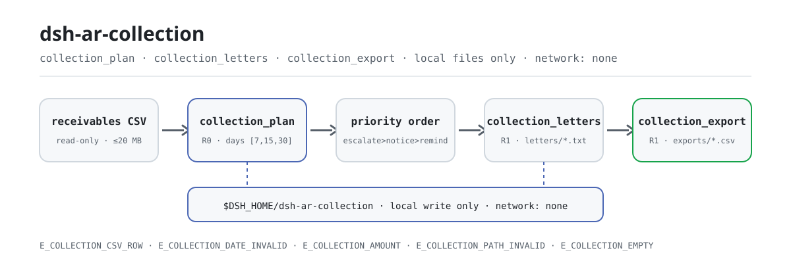
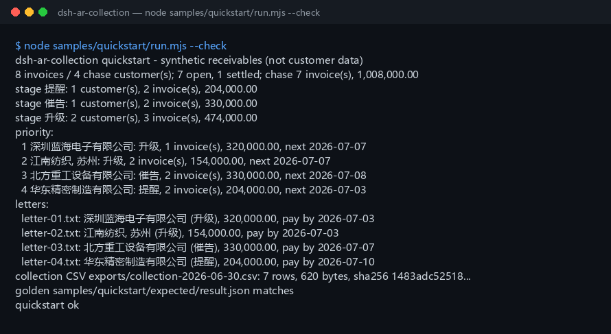

<div align="center">

<picture>
  <source media="(prefers-color-scheme: dark)" srcset="docs/assets/dsh-ar-collection-flow-dark.svg">
  
</picture>

# dsh-ar-collection

**Turn a receivables CSV into a prioritized collection plan, Chinese collection-letter drafts and a collection-list CSV — fully local, never online, never sent.**

A local-only accounts-receivable collection plugin for DeepSeek Harness: it reads the CSV you name, applies a 7/15/30-day reminder ladder, and works out which invoices each customer should be chased for and when — drafts and lists are written only on your own machine.

[Install](#three-step-setup) · [Configuration](#configuration) · [FAQ](#faq) · [简体中文](README.md) · [English](README.en.md) · [Español](README.es.md) · [Português](README.pt.md) · [हिन्दी](README.hi.md)

[](LICENSE)
[](#compatibility)
[](https://www.npmjs.com/package/dsh-ar-collection)
[](https://github.com/PerryLink/dsh-ar-collection/actions/workflows/ci.yml)
[](#compatibility)

[](https://github.com/PerryLink/dsh-ar-collection/stargazers)
[](https://www.npmjs.com/package/dsh-ar-collection)
[](https://dshfind.com/plugins/PerryLink/dsh-ar-collection?ref=badge)
[](https://gitee.com/perrylink/dsh-ar-collection)

```sh
dsh plugin --profile <profile> add dsh-ar-collection
```

</div>

<sub>Community plugin, not affiliated with DeepSeek. Canonical repository: <https://github.com/PerryLink/dsh-ar-collection> (Gitee is a mirror).</sub>

## One-liner

Apply a 7/15/30-day reminder ladder to a receivables ledger, then produce a per-customer collection plan (invoices to chase, amount, stage, next action date, priority), local Chinese letter drafts and a collection-list CSV.

> **Status: alpha / public-synthetic / partial / not counted / not GA.** No customer data, customer evidence, or production-readiness, legal or audit claim.

## Fit / not a fit

- **Fits:** 10s to 1000s of rows; chasing by customer rather than only producing an aging table; fixing a remind / notice / escalate ladder (fixed Chinese stage labels), next action date and priority; giving an AR accountant a Chinese letter draft to review; a collection list to hand to a colleague or archive.
- **Does not fit:** sending email/SMS/IM or any network delivery (this package drafts only); FX conversion; interest, penalties, bad-debt provisioning or legal advice; fully bespoke per-invoice letter templates; PDF, scans or Excel as direct input (export CSV first).

## Three-step setup

1. **Install** (pick one channel):

   ```sh
   # npm channel (recommended, published releases)
   dsh plugin --profile <profile> add dsh-ar-collection
   # git channel (latest main; equivalent to git+https://github.com/PerryLink/dsh-ar-collection.git)
   dsh plugin --profile <profile> add github:PerryLink/dsh-ar-collection
   # tarball channel: pnpm pack in this repo, then
   dsh plugin --profile <profile> add ./dsh-ar-collection-<version>.tgz
   ```

2. **Verify it mounts**:

   ```sh
   dsh --profile <profile> --dump-config | grep dsh-ar-collection
   ```

   Then paste this one line into the agent (it targets the bundled sample `samples/quickstart/input/ar-collection.csv`):

```text
我有这份 8 行应收明细，用 7/15/30 天阶梯按 2026-06-30 生成催收计划、中文催收函草稿，再导出催收清单 CSV。
```

3. **Reproduce the sample against the golden file** (optional):

   ```sh
   node samples/quickstart/run.mjs --check
   ```

**Uninstall**: `dsh plugin --profile <profile> remove dsh-ar-collection`.

<details>
<summary>Install from the DSH Desktop market</summary>

Every PerryLink plugin is listed in the built-in DSH Desktop market: **Market → Sources → Add source → paste** `https://perrylink-dsh-catalog.perrylink.workers.dev/catalog-source.json` **→ select**. Installation still requires the market's npm identity check and your confirmation.

</details>

## Core capabilities

Tool names are stable API; descriptions stay in English to match runtime output.

| Tool | Purpose | Risk |
|---|---|---|
| `collection.plan` | Read the receivables CSV and produce each customer's chased invoice/amount, stage, next action date and priority | R0 |
| `collection.letters` | Write a Chinese collection-letter `.txt` draft per chased customer under `letters/`; never sends, no network | R1 local write |
| `collection.export` | Write the collection-list CSV (customer / invoice / due date / amount / stage / action date), returning path + sha256 | R1 local write |

## Input

- UTF-8 CSV with a header row and comma separators. RFC 4180 quotes, embedded newlines, CRLF and a UTF-8 BOM are supported.
- Header (Chinese aliases work too; extra columns are ignored):

```text
customer,invoice_no,due_date,amount_cents,paid_cents,contact_email
客户,发票号,到期日,金额分,已收金额分,联系人邮箱
```

- Dates: `due_date` is strict `YYYY-MM-DD`. A due date later than `as_of` is allowed (not yet due); such an invoice stays out of the plan until it reaches the first rung.
- Amounts: integer **cents**; `amount_cents > 0` and `0 <= paid_cents <= amount_cents`; outstanding = amount - paid.
- Email: `contact_email` may be empty; when present it must look like `name@example.com`. An empty value becomes this fixed placeholder in a letter:

```text
[联系人邮箱待补充]
```

- Invoice numbers must be unique within the file.
- Size: up to 20 MB per file; split by customer or month beyond that.
- Source: the local CSV the user names; it is read-only and never modified.

## Output

- **`collection.plan`**: `{ as_of, source_sha256, policy, totals, stages, customers }`.
  - `totals`: ledger rows, open/settled invoice counts, chased invoices/customers/amount, per-stage customer counts, customers skipped by the minimum amount, and pre-ladder invoice count/amount.
  - `stages`: always the three ladder stages with customer, invoice and amount totals.
  - `customers`: priority order; each has `priority`, `invoice_count`, `amount_cents`, `stage`, `stage_label`, `next_action_date`, `next_action`, `max_days_past_due`, `oldest_due_date`, `contact_email` and per-invoice detail.
- **`collection.letters`**: one Chinese `.txt` draft per chased customer under `$DSH_HOME/dsh-ar-collection/letters/`. Each has a salutation, aging summary, detail table (invoice no / due date / days overdue / outstanding), payment deadline and contact placeholders. Returns filename, path, `sha256` and bytes. **Never sends, never uses the network.**
- **`collection.export`**: writes the collection list as CSV under `$DSH_HOME/dsh-ar-collection/exports/` with exactly six fixed columns; returns path, `sha256`, bytes and row counts. With `include_settled=true`, settled invoices are appended after each customer's chase rows (settled stage label, empty action date).

The stage labels and the export header are fixed Chinese tokens:

```text
stage labels: remind = 提醒 · notice = 催告 · escalate = 升级 · settled = 已结清
export header: 客户,票号,到期日,金额,阶梯,动作日期
```

## Rules

1. Days past due = `as_of - due_date` in whole UTC days; negative means not yet due.
2. Only open invoices at or beyond the first rung (default day 7) are chase candidates. Earlier invoices are counted in `pre_ladder_invoices` and stay out of the plan.
3. A customer's stage is the stage of its **most overdue** invoice: `remind` (7–14 days), `notice` (15–29), `escalate` (30+).
4. A customer's next action date is the earliest next-rung date across its chase invoices: `remind` → `due+15`, `notice` → `due+30`, `escalate` → `as_of + first rung day` (default +7).
5. Priority: stage severity (escalate > notice > remind), then chased amount descending, then longest days overdue, then customer name ascending.
6. `min_amount_cents` filters whole customers by their total chased amount; if every customer is filtered out, the call is `E_COLLECTION_EMPTY`.
7. With `include_settled=true`, settled-only customers are included with the settled stage label (amount 0) after every chase customer; letters are still generated only for chase customers.
8. Letter deadlines: `remind` = `as_of+10` days, `notice` = `as_of+7`, `escalate` = `as_of+3`. Contact name, phone and any missing email remain placeholders that a human must complete before sending.

## Example

Paste this one line into the agent:

```text
我有这份 8 行应收明细，用 7/15/30 天阶梯按 2026-06-30 生成催收计划、中文催收函草稿，再导出催收清单 CSV。
```

Reproduce the bundled sample and compare with the golden file:

```sh
node samples/quickstart/run.mjs --check
```



The sample is an 8-row synthetic ledger with 4 customers and 1 settled invoice. It spans all three stages (1 remind / 1 notice / 2 escalate), includes one partial payment and a customer name with a comma, which exercises CSV quoting:

```text
"江南纺织, 苏州"
```

`samples/quickstart/expected/result.json` is the real stdout of `node samples/quickstart/run.mjs --json`, not hand-written; the screenshot is the real `--check` output.

## Configuration

The plugin itself has no cordis config keys (`cordis.patch.yml` only `insert`s one row, no `config`); every tunable is a tool argument:

| Argument | Default | Meaning |
|---|---|---|
| `path` | (required) | Local path of the receivables CSV; read-only, never modified |
| `as_of` | (required) | Baseline date `YYYY-MM-DD`; pass it explicitly for a reproducible "today" |
| `days` | `[7,15,30]` | Start day of each of the three ladder rungs; three strictly increasing positive integers, e.g. `[3,5,10]`, `[10,20,45]` |
| `min_amount_cents` | `0` | Minimum chased total **per customer** (integer cents); customers below it are skipped whole |
| `include_settled` | `false` | `true` lists settled-only customers with the settled stage label and appends settled rows to the export; letters still cover chase customers only |
| `filename_prefix` | `letter` | `collection.letters` only: letter filename prefix |
| `filename` | derived from `as_of` | `collection.export` only: export filename, `[A-Za-z0-9._-]` characters only |

Tests can override the local write root with the `DSH_AR_COLLECTION_HOME` environment variable; the default is exactly `$DSH_HOME/dsh-ar-collection`.

## Permissions

Read: the receivables CSV the user names (sample: `samples/quickstart/input/ar-collection.csv`); nothing else.
Write: `$DSH_HOME/dsh-ar-collection/letters/` (letter drafts) and `$DSH_HOME/dsh-ar-collection/exports/` (collection CSV) only; the source CSV is not modified.
Network: no.
External systems: none.

`collection.plan` is **R0** (read-only). `collection.letters` and `collection.export` are **R1** (local write under the two folders above). `DSH_AR_COLLECTION_HOME` can override the local write root for tests; the default is exactly `$DSH_HOME/dsh-ar-collection`.

## FAQ

<details>
<summary>Are letters sent automatically?</summary>

No. `collection.letters` writes `.txt` drafts locally and never calls email, SMS, IM, HTTP or any external system. Contact name, phone and a missing email stay as placeholders; a human must review and complete them before sending. This package does not make the send decision for you.

</details>

<details>
<summary>Can the ladder be changed?</summary>

Yes. `days` must be three strictly increasing positive integers, default `[7,15,30]`, for example `[3,5,10]` or `[10,20,45]`. The three stage names stay the fixed Chinese labels (remind / notice / escalate); only their start days move.

</details>

<details>
<summary>Why are settled invoices excluded?</summary>

With the default `include_settled=false`, settled invoices only count in `totals.settled_invoices`; they are not chased, exported or lettered. With `include_settled=true`, settled-only customers appear with the settled stage label (amount 0) and settled rows are appended to the export; letters still only cover chase customers.

</details>

<details>
<summary>Is the minimum amount per invoice or per customer?</summary>

Per **customer chased total**. If a customer's chase invoices add up below `min_amount_cents`, the whole customer is skipped and counted in `totals.below_min_customers`.

</details>

<details>
<summary>Are amounts in yuan or cents?</summary>

Inputs and tool APIs use integer **cents**. `12800000` means 128,000.00. Letters and CSV render two decimals; letters also add thousands separators.

</details>

<details>
<summary>Does it modify or upload my file?</summary>

No. It reads the named CSV, writes only under the two folders below `$DSH_HOME/dsh-ar-collection/`, and never uses the network, a model call or an upload. The source CSV is not modified.

</details>

## Version

`0.1.0` · 83 tests pass (`node --test test/*.test.mjs`).

## Errors

| Code | When | Next action |
|---|---|---|
| `E_COLLECTION_CSV_ROW` | Wrong column count, missing/duplicate header, empty customer/invoice, duplicate invoice, bad email, invalid ladder, file > 20 MB | Fix the named row; `days` must be three strictly increasing positive integers |
| `E_COLLECTION_DATE_INVALID` | `due_date` or `as_of` is not a real `YYYY-MM-DD` date | Use ISO dates and check they exist |
| `E_COLLECTION_AMOUNT` | Not a positive integer of cents, zero amount, paid above amount, negative/fractional `min_amount_cents` | Integer cents with `0 <= paid <= amount` |
| `E_COLLECTION_PATH_INVALID` | Missing/directory/unreadable input, unsafe export filename, or a write failure | Pass an existing CSV; export with `[A-Za-z0-9._-]` only |
| `E_COLLECTION_EMPTY` | Empty/header-only CSV, everything settled, no customer past the first rung, or all below the minimum | Check `as_of` and `days`; pass `include_settled=true` to see settled customers |

The message format is:

```text
<one sentence>（E_COLLECTION_XXX）｜下一步：<one action>
```

See [TROUBLESHOOTING.md](TROUBLESHOOTING.md).

## Acceptance evidence

Public/synthetic fixtures live in `samples/quickstart/`; `ACCEPTANCE.csv` records 14 tool checks plus the quickstart golden. Every row is `counted=false` except the quickstart row.

| req_id | metric | threshold | actual | pass | source | counted |
|---|---|---|---|---|---|---|
| AC-A01 | plan totals | rows=8 chase=7 amount=100800000 | rows=8 chase=7 amount=100800000 | true | public/synthetic | false |
| AC-A02 | three ladder stages | remind/notice/escalate = 1/1/2 | remind/notice/escalate = 1/1/2 | true | public/synthetic | false |
| AC-A03 | priority order | D/C/B/A | D/C/B/A | true | public/synthetic | false |
| AC-A05 | letter drafts | count=4 sections=ok | count=4 sections=ok | true | public/synthetic | false |
| AC-A06 | collection CSV | rows=7 lines=8 | rows=7 lines=8 | true | public/synthetic | false |
| PS1-QS01 | quickstart golden | 1/1 | 1 | true | synthetic/quickstart | true |

*Fixture-backed rows, not a customer run; no output is invented.*

## Limits and known limitations

- **No sending:** local drafts only; no email/SMS/IM integration, delivery status, bounce or reply tracking.
- **No currency model:** the input has no currency column, so all amounts are assumed to be one currency. Split files or convert in the source system.
- **Principal only:** no interest, penalties, bad-debt provision or impairment.
- **No credit notes:** `amount_cents` must be > 0; offset red invoices in the source system first.
- **Fixed template:** one built-in Chinese template; no multilingual letters, PDF attachments, e-signature or postal delivery.
- CSV only: no PDF, scans or Excel, and no OCR.
- Dates use UTC calendar days; pass `as_of` explicitly for a reproducible "today".
- Exported CSV uses RFC 4180 quoting only; Excel formula prefixes are not sanitised.
- Local only: no network, no model call, no upload.
- Public/synthetic samples only; alpha/partial, not counted, no GA or production-readiness claim.

## Compatibility

| Surface | Status |
|---|---|
| Harness | `dsh >=0.2.1-rc.3 <0.4.0` |
| Node | `>=24.9.0 <25` |
| Platforms | All; local files only |
| Data | No network, no model call, no upload |

## Ecosystem & quality

- [Gitee mirror](https://gitee.com/perrylink/dsh-ar-collection) (sync mirror; GitHub is canonical)
- [dshfind plugin page](https://dshfind.com/plugins/PerryLink/dsh-ar-collection) (installs and ranking)

## Development

```sh
pnpm install --frozen-lockfile
pnpm build && pnpm lint && pnpm typecheck
node --test test/*.test.mjs
node scripts/gate.mjs
```

The README flow diagram is generated programmatically by [`scripts/gen-readme-assets.py`](scripts/gen-readme-assets.py) (Python + Pillow) and is safe to re-run; `docs/assets/quickstart.png` is the real `--check` terminal screenshot and is not overwritten by the script.

Topics: `dsh`, `dsh-plugin`, `deepseek-harness`, `accounts-receivable`, `collections`, `dunning`, `receivables`, `finance`, `csv`, `perrylink`

## Related work

- [dsh-ar-aging](https://github.com/PerryLink/dsh-ar-aging) (AR aging)
- [dsh-bankrec](https://github.com/PerryLink/dsh-bankrec) (bank statement reconciliation)
- [Domain index](https://perrylink.github.io/dsh-plugins/)

## Family & thanks

This project is part of the DeepSeek Harness plugin family from [PerryLink](https://github.com/PerryLink) (all Apache-2.0). If it is useful, **a star helps the next person find it** — nothing is gated behind it.

- [@PerryLink](https://github.com/PerryLink) — creator and maintainer.

## License

[LICENSE](LICENSE) (Apache License 2.0) © 2026 dsh-ar-collection contributors. See also `NOTICE`, `THIRD-PARTY-NOTICES`.

<p align="center"><sub>Apache-2.0 · Community plugin, not affiliated with DeepSeek.</sub></p>
