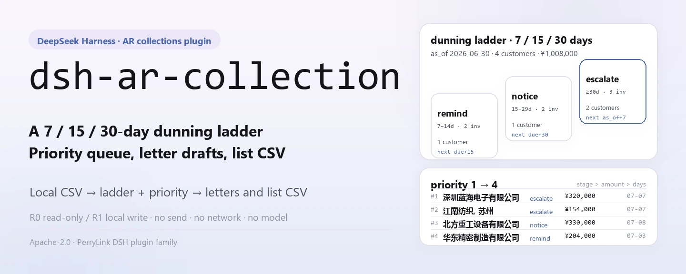
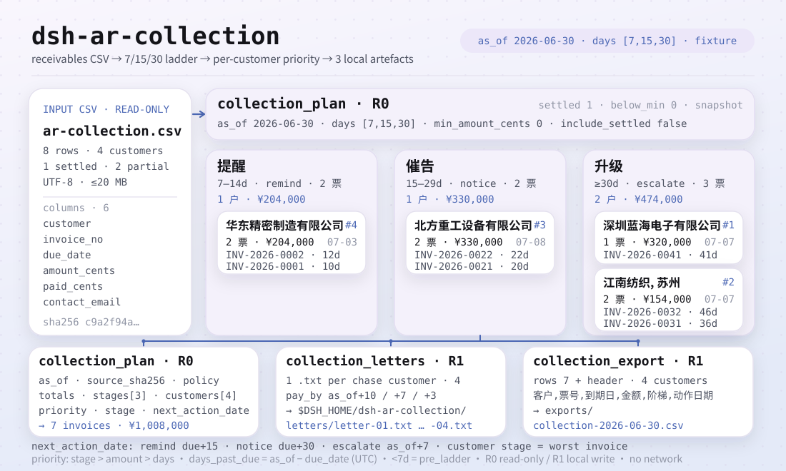
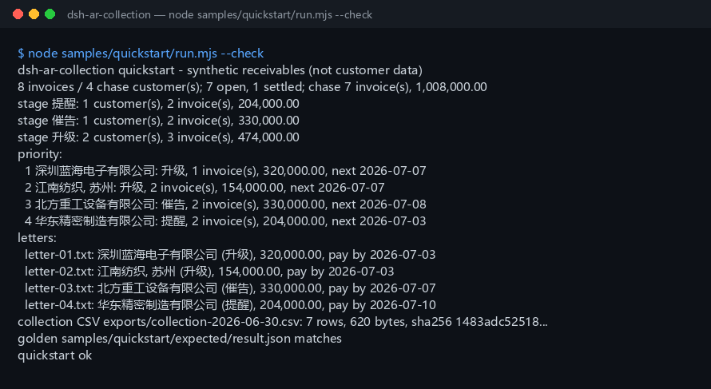

<div align="center">

<picture>
  <source media="(prefers-color-scheme: dark)" srcset="docs/assets/dsh-ar-collection-hero-en-dark.webp">
  
</picture>

# dsh-ar-collection

**Convierte un CSV de cuentas por cobrar en un plan de cobro priorizado, borradores de cartas de cobro en chino y un CSV con la lista de cobro — todo local, sin red y sin envíos.**

Un plugin de cobranza puramente local para DeepSeek Harness: lee el CSV que tú indicas, aplica una escalera de recordatorios de 7/15/30 días y calcula qué facturas hay que reclamar a cada cliente y cuándo; los borradores y las listas solo se escriben en tu propia máquina.

[Instalar](#instalación-en-tres-pasos) · [Configuración](#configuración) · [FAQ](#faq) · [简体中文](README.md) · [English](README.en.md) · [Español](README.es.md) · [Português](README.pt.md) · [हिन्दी](README.hi.md)

[](LICENSE)
[](#compatibilidad)
[](https://www.npmjs.com/package/dsh-ar-collection)
[](https://github.com/PerryLink/dsh-ar-collection/actions/workflows/ci.yml)
[](#compatibilidad)

[](https://github.com/PerryLink/dsh-ar-collection/stargazers)
[](https://www.npmjs.com/package/dsh-ar-collection)
[](https://dshfind.com/plugins/PerryLink/dsh-ar-collection?ref=badge)
[](https://gitee.com/perrylink/dsh-ar-collection)

```sh
dsh plugin --profile <profile> add dsh-ar-collection
```

</div>

<sub>Plugin de la comunidad, no afiliado a DeepSeek. Repositorio canónico: <https://github.com/PerryLink/dsh-ar-collection> (Gitee es un espejo).</sub>

## En una frase

Aplica una escalera de recordatorios de 7/15/30 días a un libro de cuentas por cobrar y produce un plan de cobro por cliente (facturas a reclamar, importe, escalón, próxima fecha de acción, prioridad), borradores de cartas en chino y un CSV con la lista de cobro, todo en local.

> **Estado: alpha / sintético-público / parcial / no contado / no GA.** Sin datos de clientes, sin evidencia de clientes y sin declaración de idoneidad para producción, legal o de auditoría.

<picture>
  <source media="(prefers-color-scheme: dark)" srcset="docs/assets/dsh-ar-collection-flow-v5-dark.svg">
  
</picture>

## Cuándo encaja y cuándo no

- **Encaja:** de decenas a miles de filas; cobrar por cliente en lugar de limitarse a una tabla de antigüedad; fijar la escalera `提醒` / `催告` / `升级`, la próxima fecha de acción y la prioridad; dar al contable de cartera un borrador de carta en chino listo para revisar; entregar una lista de cobro a un colega o archivarla.
- **No encaja:** enviar email/SMS/IM ni ninguna entrega por red (este paquete solo redacta borradores); conversión de divisas; intereses, penalizaciones, provisiones por incobrable o asesoría legal; plantillas de carta distintas por factura; PDF, escaneos o Excel como entrada directa (exporta primero a CSV).

## Instalación en tres pasos

1. **Instala** (elige un canal):

   ```sh
   # canal npm (recomendado, versiones publicadas)
   dsh plugin --profile <profile> add dsh-ar-collection
   # canal git (último main; equivalente a git+https://github.com/PerryLink/dsh-ar-collection.git)
   dsh plugin --profile <profile> add github:PerryLink/dsh-ar-collection
   # canal tarball: pnpm pack en este repo y luego
   dsh plugin --profile <profile> add ./dsh-ar-collection-<version>.tgz
   ```

2. **Verifica que se monta**:

   ```sh
   dsh --profile <profile> --dump-config | grep dsh-ar-collection
   ```

   Luego pega esta frase al agente (apunta al ejemplo incluido `samples/quickstart/input/ar-collection.csv`):

   ```text
   我有这份 8 行应收明细，用 7/15/30 天阶梯按 2026-06-30 生成催收计划、中文催收函草稿，再导出催收清单 CSV。
   ```

3. **Reproduce el ejemplo y compara con el archivo dorado** (opcional):

   ```sh
   node samples/quickstart/run.mjs --check
   ```

**Desinstalar**: `dsh plugin --profile <profile> remove dsh-ar-collection`.

<details>
<summary>Instalar desde el mercado de DSH Desktop</summary>

Todos los plugins de PerryLink pueden explorarse en el mercado integrado de DSH Desktop: **Market → Sources → Add source → pegar** `https://perrylink-dsh-catalog.perrylink.workers.dev/catalog-source.json` **→ seleccionarlo**. La instalación sigue pasando por la verificación de identidad npm del mercado y tu confirmación.

</details>

## Capacidades clave

Los nombres de las herramientas son API estable; las descripciones se mantienen en inglés para coincidir con la salida en tiempo de ejecución.

| Herramienta | Propósito | Riesgo |
|---|---|---|
| `collection_plan` | Lee el CSV de cuentas por cobrar y produce las facturas/importes a reclamar de cada cliente, su escalón, la próxima fecha de acción y la prioridad | R0 |
| `collection_letters` | Escribe un borrador de carta de cobro china `.txt` por cliente reclamable bajo `letters/`; nunca envía, sin red | R1 escritura local |
| `collection_export` | Escribe el CSV de la lista de cobro (cliente / factura / vencimiento / importe / escalón / fecha de acción), devolviendo ruta + sha256 | R1 escritura local |

## Entrada

- CSV UTF-8 con fila de cabecera y separadores de coma. Se admiten comillas RFC 4180, saltos de línea incrustados, CRLF y BOM UTF-8.
- Cabecera (también valen los alias chinos; las columnas extra se ignoran):

  ```text
  customer,invoice_no,due_date,amount_cents,paid_cents,contact_email
  客户,发票号,到期日,金额分,已收金额分,联系人邮箱
  ```

- Fechas: `due_date` es estrictamente `YYYY-MM-DD`. Se permite un vencimiento posterior a `as_of` (aún no vencida); esa factura queda fuera del plan hasta alcanzar el primer peldaño.
- Importes: **céntimos** enteros; `amount_cents > 0` y `0 <= paid_cents <= amount_cents`; pendiente = importe - cobrado.
- Email: `contact_email` puede estar vacío; si tiene valor debe parecer `name@example.com`. Un valor vacío se convierte en este marcador fijo dentro de la carta:

  ```text
  [联系人邮箱待补充]
  ```

- Los números de factura deben ser únicos dentro del archivo.
- Tamaño: hasta 20 MB por archivo; por encima, divide por cliente o por mes.
- Fuente: el CSV local que indique el usuario; es de solo lectura y nunca se modifica.

## Salida

- **`collection_plan`**: `{ as_of, source_sha256, policy, totals, stages, customers }`.
  - `totals`: filas del libro, facturas abiertas/liquidadas, facturas/clientes/importe reclamables, clientes por escalón, clientes omitidos por el importe mínimo y facturas/importe previos a la escalera.
  - `stages`: siempre los tres escalones de la escalera con totales de clientes, facturas e importe.
  - `customers`: ordenados por prioridad; cada uno tiene `priority`, `invoice_count`, `amount_cents`, `stage`, `stage_label`, `next_action_date`, `next_action`, `max_days_past_due`, `oldest_due_date`, `contact_email` y el detalle por factura.
- **`collection_letters`**: un borrador `.txt` en chino por cliente reclamable bajo `$DSH_HOME/dsh-ar-collection/letters/`. Cada carta lleva saludo, resumen de antigüedad, tabla de detalle (nº de factura / vencimiento / días de mora / pendiente), fecha límite de pago y marcadores de contacto. Devuelve nombre de archivo, ruta, `sha256` y bytes. **Nunca envía, nunca usa la red.**
- **`collection_export`**: escribe la lista de cobro como CSV bajo `$DSH_HOME/dsh-ar-collection/exports/` con exactamente seis columnas fijas; devuelve ruta, `sha256`, bytes y recuentos de filas. Con `include_settled=true`, las facturas liquidadas se añaden tras las filas reclamables de cada cliente (etiqueta de escalón `已结清`, fecha de acción vacía).

Las etiquetas de escalón y la cabecera del CSV exportado son tokens chinos fijos:

```text
stage labels: remind = 提醒 · notice = 催告 · escalate = 升级 · settled = 已结清
export header: 客户,票号,到期日,金额,阶梯,动作日期
```

## Reglas

1. Días de mora = `as_of - due_date` en días UTC completos; negativo significa aún no vencida.
2. Solo las facturas abiertas en el primer peldaño o más allá (día 7 por defecto) son candidatas a cobro. Las anteriores se cuentan en `pre_ladder_invoices` y quedan fuera del plan.
3. El escalón de un cliente es el de su factura **más atrasada**: `提醒` (7–14 días), `催告` (15–29), `升级` (30+).
4. La próxima fecha de acción de un cliente es la fecha del siguiente peldaño más temprana entre sus facturas reclamables: `提醒` → `due+15`, `催告` → `due+30`, `升级` → `as_of + primer día de la escalera` (por defecto +7).
5. Prioridad: severidad del escalón (`升级` > `催告` > `提醒`), luego importe reclamable descendente, luego mayor mora, luego nombre de cliente ascendente.
6. `min_amount_cents` filtra clientes enteros por su total reclamable; si todos quedan filtrados, la llamada devuelve `E_COLLECTION_EMPTY`.
7. Con `include_settled=true`, los clientes solo liquidados se incluyen con el escalón `已结清` (importe 0) tras todos los clientes reclamables; las cartas siguen generándose solo para clientes reclamables.
8. Plazos de pago en las cartas: `提醒` = `as_of+10` días, `催告` = `as_of+7`, `升级` = `as_of+3`. Nombre de contacto, teléfono y cualquier email ausente quedan como marcadores que una persona debe completar antes de enviar.

## Ejemplo

Pega esta frase al agente:

```text
我有这份 8 行应收明细，用 7/15/30 天阶梯按 2026-06-30 生成催收计划、中文催收函草稿，再导出催收清单 CSV。
```

Reproduce el ejemplo incluido y compara con el archivo dorado:

```sh
node samples/quickstart/run.mjs --check
```



El ejemplo es un libro sintético de 8 filas con 4 clientes y 1 factura liquidada. Cubre los tres escalones (1 `提醒` / 1 `催告` / 2 `升级`), incluye un pago parcial y un nombre de cliente con coma, que ejercita el entrecomillado CSV:

```text
"江南纺织, 苏州"
```

`samples/quickstart/expected/result.json` es la salida real de `node samples/quickstart/run.mjs --json`, no escrita a mano; la captura es la salida real de `--check`.

## Configuración

El plugin en sí no tiene claves de configuración cordis (`cordis.patch.yml` solo hace `insert` de una fila, sin `config`); todos los ajustes son argumentos de las herramientas:

| Argumento | Predeterminado | Significado |
|---|---|---|
| `path` | (obligatorio) | Ruta local del CSV de cuentas por cobrar; solo lectura, nunca se modifica |
| `as_of` | (obligatorio) | Fecha base `YYYY-MM-DD`; pásala explícitamente para un «hoy» reproducible |
| `days` | `[7,15,30]` | Día de inicio de cada peldaño; tres enteros positivos estrictamente crecientes, p. ej. `[3,5,10]`, `[10,20,45]` |
| `min_amount_cents` | `0` | Total reclamable mínimo **por cliente** (céntimos enteros); los clientes por debajo se omiten enteros |
| `include_settled` | `false` | `true` lista los clientes solo liquidados con el escalón `已结清` y añade filas liquidadas al export; las cartas siguen cubriendo solo clientes reclamables |
| `filename_prefix` | `letter` | Solo `collection_letters`: prefijo del nombre de archivo de las cartas |
| `filename` | derivado de `as_of` | Solo `collection_export`: nombre del archivo exportado, solo caracteres `[A-Za-z0-9._-]` |

Las pruebas pueden sobrescribir la raíz de escritura local con la variable de entorno `DSH_AR_COLLECTION_HOME`; el valor por defecto es exactamente `$DSH_HOME/dsh-ar-collection`.

## Permisos

Lectura: el CSV de cuentas por cobrar que indique el usuario (ejemplo: `samples/quickstart/input/ar-collection.csv`); nada más.
Escritura: `$DSH_HOME/dsh-ar-collection/letters/` (borradores de cartas) y `$DSH_HOME/dsh-ar-collection/exports/` (CSV de cobro) únicamente; el CSV fuente no se modifica.
Red: no.
Sistemas externos: ninguno.

`collection_plan` es **R0** (solo lectura). `collection_letters` y `collection_export` son **R1** (escritura local solo en las dos carpetas anteriores). `DSH_AR_COLLECTION_HOME` puede sobrescribir la raíz de escritura local en pruebas; el valor por defecto es exactamente `$DSH_HOME/dsh-ar-collection`.

## FAQ

<details>
<summary>¿Las cartas se envían automáticamente?</summary>

No. `collection_letters` escribe borradores `.txt` en local y nunca llama a email, SMS, IM, HTTP ni a ningún sistema externo. Nombre de contacto, teléfono y un email ausente quedan como marcadores; una persona debe revisarlos y completarlos antes de enviar. Este paquete no decide el envío por ti.

</details>

<details>
<summary>¿Se puede cambiar la escalera?</summary>

Sí. `days` debe ser tres enteros positivos estrictamente crecientes, por defecto `[7,15,30]`, por ejemplo `[3,5,10]` o `[10,20,45]`. Los tres nombres de escalón siguen siendo las etiquetas chinas fijas (`提醒` / `催告` / `升级`); solo se mueven sus días de inicio.

</details>

<details>
<summary>¿Por qué se excluyen las facturas liquidadas?</summary>

Con el valor por defecto `include_settled=false`, las facturas liquidadas solo cuentan en `totals.settled_invoices`; no se reclaman, ni se exportan, ni reciben carta. Con `include_settled=true`, los clientes solo liquidados aparecen con el escalón `已结清` (importe 0) y las filas liquidadas se añaden al export; las cartas siguen cubriendo solo a los clientes reclamables.

</details>

<details>
<summary>¿El importe mínimo es por factura o por cliente?</summary>

Por **total reclamable del cliente**. Si las facturas reclamables de un cliente suman menos de `min_amount_cents`, el cliente entero se omite y se cuenta en `totals.below_min_customers`.

</details>

<details>
<summary>¿Los importes son en yuan o en céntimos?</summary>

Las entradas y las API de las herramientas usan **céntimos** enteros. `12800000` significa 128.000,00. Las cartas y el CSV muestran dos decimales; las cartas además añaden separadores de miles.

</details>

<details>
<summary>¿Modifica o sube mi archivo?</summary>

No. Lee el CSV indicado, escribe solo bajo las dos carpetas de `$DSH_HOME/dsh-ar-collection/` y nunca usa la red, ni una llamada al modelo, ni una subida. El CSV fuente no se modifica.

</details>

## Versión

`0.2.0` · 85 pruebas pasan (`node --test test/*.test.mjs`).

## Códigos de error

| Código | Cuándo | Próxima acción |
|---|---|---|
| `E_COLLECTION_CSV_ROW` | Número de columnas incorrecto, cabecera ausente/duplicada, cliente/factura vacíos, factura duplicada, email inválido, escalera inválida, archivo > 20 MB | Corrige la fila indicada; `days` debe ser tres enteros positivos estrictamente crecientes |
| `E_COLLECTION_DATE_INVALID` | `due_date` o `as_of` no es una fecha `YYYY-MM-DD` real | Usa fechas ISO y comprueba que existen |
| `E_COLLECTION_AMOUNT` | Céntimos no enteros positivos, importe cero, cobrado por encima del importe, `min_amount_cents` negativo/fraccionario | Céntimos enteros con `0 <= paid <= amount` |
| `E_COLLECTION_PATH_INVALID` | Entrada ausente/directorio/ilegible, nombre de exportación inseguro o fallo de escritura | Pasa un CSV existente; exporta solo con `[A-Za-z0-9._-]` |
| `E_COLLECTION_EMPTY` | CSV vacío/solo cabecera, todo liquidado, ningún cliente supera el primer peldaño o todos por debajo del mínimo | Revisa `as_of` y `days`; pasa `include_settled=true` para ver clientes liquidados |

El formato del mensaje es:

```text
<one sentence>（E_COLLECTION_XXX）｜下一步：<one action>
```

Véase [TROUBLESHOOTING.md](TROUBLESHOOTING.md).

## Evidencia de aceptación

Los fixtures públicos/sintéticos viven en `samples/quickstart/`; `ACCEPTANCE.csv` registra 14 comprobaciones de herramientas más el dorado del quickstart. Todas las filas son `counted=false` excepto la del quickstart.

| req_id | metric | threshold | actual | pass | source | counted |
|---|---|---|---|---|---|---|
| AC-A01 | plan totals | rows=8 chase=7 amount=100800000 | rows=8 chase=7 amount=100800000 | true | public/synthetic | false |
| AC-A02 | three ladder stages | remind/notice/escalate = 1/1/2 | remind/notice/escalate = 1/1/2 | true | public/synthetic | false |
| AC-A03 | priority order | D/C/B/A | D/C/B/A | true | public/synthetic | false |
| AC-A05 | letter drafts | count=4 sections=ok | count=4 sections=ok | true | public/synthetic | false |
| AC-A06 | collection CSV | rows=7 lines=8 | rows=7 lines=8 | true | public/synthetic | false |
| PS1-QS01 | quickstart golden | 1/1 | 1 | true | synthetic/quickstart | true |

*Filas respaldadas por fixtures, no una ejecución de cliente; no se inventa ninguna salida.*

## Límites y limitaciones conocidas

- **Sin envíos:** solo borradores locales; sin integración de email/SMS/IM, ni estado de entrega, ni seguimiento de rebotes o respuestas.
- **Sin modelo de divisa:** la entrada no tiene columna de moneda, así que todos los importes se interpretan como una única divisa. Divide archivos o convierte en el sistema de origen.
- **Solo principal:** sin intereses, penalizaciones, provisión por incobrable ni deterioro.
- **Sin notas de crédito:** `amount_cents` debe ser > 0; compensa primero las facturas rectificativas en el sistema de origen.
- **Plantilla fija:** una plantilla china incorporada; sin cartas multilingües, adjuntos PDF, firma electrónica ni envío postal.
- Solo CSV: nada de PDF, escaneos o Excel, y nada de OCR.
- Las fechas usan días naturales UTC; pasa `as_of` explícitamente para un «hoy» reproducible.
- El CSV exportado solo aplica entrecomillado RFC 4180; no se sanea el prefijo de fórmula de Excel.
- Solo local: sin red, sin llamadas al modelo, sin subidas.
- Solo muestras públicas/sintéticas; alpha/parcial, no contado, sin declaración de GA ni de idoneidad para producción.

## Compatibilidad

| Superficie | Estado |
|---|---|
| Harness | `dsh >=0.2.1-rc.3 <0.4.0` |
| Node | `>=24.9.0 <25` |
| Plataformas | Todas; solo archivos locales |
| Datos | Sin red, sin llamadas al modelo, sin subidas |

## Ecosistema y calidad

- [Espejo de Gitee](https://gitee.com/perrylink/dsh-ar-collection) (espejo sincronizado; GitHub es el canónico)
- [Página del plugin en dshfind](https://dshfind.com/plugins/PerryLink/dsh-ar-collection) (instalaciones y ranking)

## Desarrollo

```sh
pnpm install --frozen-lockfile
pnpm build && pnpm lint && pnpm typecheck
node --test test/*.test.mjs
node scripts/gate.mjs
```

El diagrama de flujo del README se genera programáticamente con [`scripts/gen-readme-assets.py`](scripts/gen-readme-assets.py) (Python + Pillow) y puede reejecutarse sin riesgo; `docs/assets/quickstart.png` es la captura de terminal real de `--check` y el script no la sobrescribe.

Topics: `dsh`, `dsh-plugin`, `deepseek-harness`, `accounts-receivable`, `collections`, `dunning`, `receivables`, `finance`, `csv`, `perrylink`

## Proyectos relacionados

- [dsh-ar-aging](https://github.com/PerryLink/dsh-ar-aging) (antigüedad de cuentas por cobrar)
- [dsh-bankrec](https://github.com/PerryLink/dsh-bankrec) (conciliación bancaria)
- [Índice de dominios](https://perrylink.github.io/dsh-plugins/)

## Familia y agradecimientos

Este proyecto forma parte de la familia de plugins de DeepSeek Harness de [PerryLink](https://github.com/PerryLink) (todos Apache-2.0). Si te resulta útil, **una estrella ayuda a que la siguiente persona lo encuentre** — no hay nada bloqueado tras ella.

- [@PerryLink](https://github.com/PerryLink) — creador y mantenedor.

## Licencia

[LICENSE](LICENSE) (Apache License 2.0) © 2026 dsh-ar-collection contributors. Véase también `NOTICE`, `THIRD-PARTY-NOTICES`.

<p align="center"><sub>Apache-2.0 · Plugin de la comunidad, no afiliado a DeepSeek.</sub></p>
