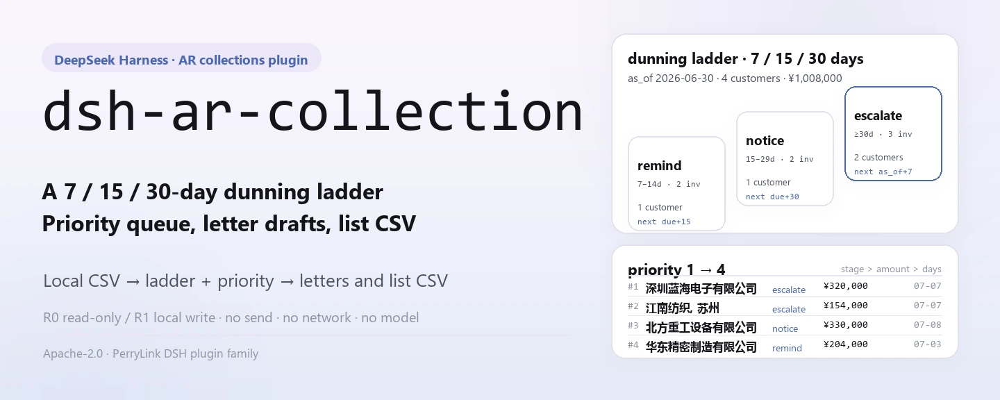
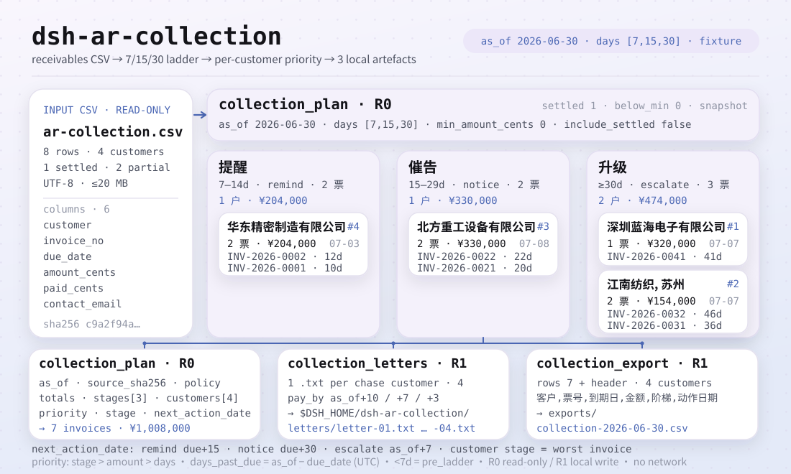
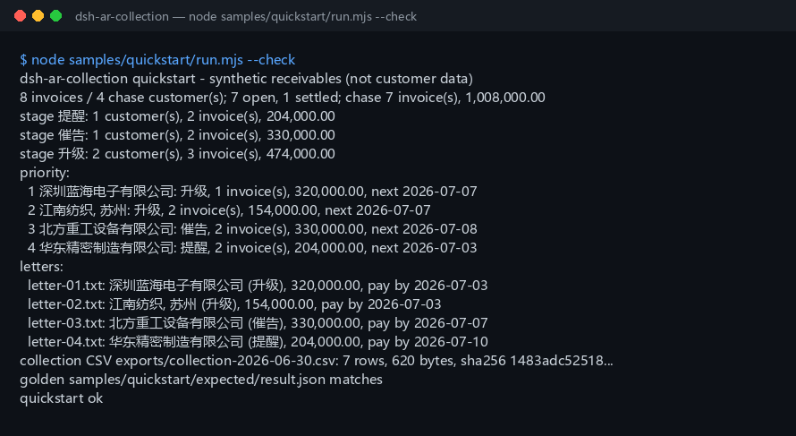

<div align="center">

<picture>
  <source media="(prefers-color-scheme: dark)" srcset="docs/assets/dsh-ar-collection-hero-en-dark.webp">
  
</picture>

# dsh-ar-collection

**प्राप्य (receivables) CSV को प्राथमिकता-क्रमित वसूली योजना, चीनी भाषा के वसूली-पत्र ड्राफ़्ट और वसूली सूची CSV में बदलें — पूरी तरह लोकल, बिना नेटवर्क, बिना भेजे।**

DeepSeek Harness के लिए शुद्ध लोकल वसूली प्लगइन: यह आपके बताए CSV को पढ़ता है, 7/15/30 दिन की रिमाइंडर सीढ़ी लगाता है और हर ग्राहक से कौन-कौन सी फ़्राप्तियाँ कब माँगनी हैं, यह निकाल देता है; ड्राफ़्ट और सूचियाँ सिर्फ़ आपकी अपनी मशीन पर लिखी जाती हैं।

[इंस्टॉल](#तीन-चरणों-में-शुरुआत) · [कॉन्फ़िगरेशन](#कॉन्फ़िगरेशन) · [FAQ](#faq) · [简体中文](README.md) · [English](README.en.md) · [Español](README.es.md) · [Português](README.pt.md) · [हिन्दी](README.hi.md)

[](LICENSE)
[](#संगतता)
[](https://www.npmjs.com/package/dsh-ar-collection)
[](https://github.com/PerryLink/dsh-ar-collection/actions/workflows/ci.yml)
[](#संगतता)

[](https://github.com/PerryLink/dsh-ar-collection/stargazers)
[](https://www.npmjs.com/package/dsh-ar-collection)
[](https://dshfind.com/plugins/PerryLink/dsh-ar-collection?ref=badge)
[](https://gitee.com/perrylink/dsh-ar-collection)

```sh
dsh plugin --profile <profile> add dsh-ar-collection
```

</div>

<sub>सामुदायिक प्लगइन, DeepSeek से असंबद्ध। कैनोनिकल रिपॉज़िटरी: <https://github.com/PerryLink/dsh-ar-collection> (Gitee एक मिरर है)।</sub>

## एक पंक्ति में

7/15/30 दिन की रिमाइंडर सीढ़ी प्राप्य बही-खाते पर लगाकर हर ग्राहक की वसूली योजना (माँगनी जाने वाली फ़्राप्तियाँ, राशि, चरण, अगली कार्रवाई तिथि, प्राथमिकता), लोकल चीनी पत्र-ड्राफ़्ट और वसूली सूची CSV तैयार करता है।

> **स्थिति: alpha / सार्वजनिक-सिंथेटिक / आंशिक / गिनती में नहीं / GA नहीं।** कोई ग्राहक डेटा, ग्राहक साक्ष्य या उत्पादन-तैयारी, कानूनी या ऑडिट दावा नहीं।

<picture>
  <source media="(prefers-color-scheme: dark)" srcset="docs/assets/dsh-ar-collection-flow-v5-dark.svg">
  
</picture>

## किसके लिए उपयुक्त / किसके लिए नहीं

- **उपयुक्त:** कई दसकों से लेकर हज़ारों पंक्तियों तक की प्राप्य डेटा; सिर्फ़ ageing तालिका के बजाय ग्राहक-वार वसूली; `提醒` / `催告` / `升级` सीढ़ी, अगली कार्रवाई तिथि और प्राथमिकता तय करना; AR अकाउंटेंट को समीक्षा के लिए चीनी पत्र-ड्राफ़्ट देना; वसूली सूची सहकर्मी को सौंपना या संग्रहीत करना।
- **उपयुक्त नहीं:** ईमेल/SMS/IM या कोई भी नेटवर्क डिलीवरी भेजना (यह पैकेज केवल ड्राफ़्ट बनाता है); विदेशी मुद्रा रूपांतरण; ब्याज, ज़ुर्माना, डूबत प्रावधान या कानूनी सलाह; हर फ़्राप्ति के लिए अलग पत्र-टेम्पलेट; PDF, स्कैन या Excel की सीधी इनपुट (पहले CSV निर्यात करें)।

## तीन चरणों में शुरुआत

1. **इंस्टॉल करें** (एक चैनल चुनें):

   ```sh
   # npm चैनल (अनुशंसित, प्रकाशित रिलीज़)
   dsh plugin --profile <profile> add dsh-ar-collection
   # git चैनल (नवीनतम main; git+https://github.com/PerryLink/dsh-ar-collection.git के बराबर)
   dsh plugin --profile <profile> add github:PerryLink/dsh-ar-collection
   # tarball चैनल: इस रेपो में pnpm pack करके
   dsh plugin --profile <profile> add ./dsh-ar-collection-<version>.tgz
   ```

2. **माउंट सत्यापित करें**:

   ```sh
   dsh --profile <profile> --dump-config | grep dsh-ar-collection
   ```

   फिर यह वाक्य agent को दें (यह बंडल किए गए नमूने `samples/quickstart/input/ar-collection.csv` पर चलता है):

   ```text
   我有这份 8 行应收明细，用 7/15/30 天阶梯按 2026-06-30 生成催收计划、中文催收函草稿，再导出催收清单 CSV。
   ```

3. **नमूना दोहराकर गोल्डन फ़ाइल से मिलाएँ** (वैकल्पिक):

   ```sh
   node samples/quickstart/run.mjs --check
   ```

**अनइंस्टॉल**: `dsh plugin --profile <profile> remove dsh-ar-collection`।

<details>
<summary>DSH Desktop मार्केट से इंस्टॉल करें</summary>

सभी PerryLink प्लगइन DSH Desktop के अंतर्निहित मार्केट में ब्राउज़ किए जा सकते हैं: **Market → Sources → Add source → पेस्ट करें** `https://perrylink-dsh-catalog.perrylink.workers.dev/catalog-source.json` **→ चुनें**। इंस्टॉलेशन के लिए मार्केट की npm पहचान जाँच और आपकी पुष्टि आवश्यक रहती है।

</details>

## मुख्य क्षमताएँ

टूल के नाम स्थिर API हैं; विवरण रनटाइम आउटपुट से मिलाने के लिए अंग्रेज़ी में रखे गए हैं।

| टूल | उद्देश्य | जोखिम |
|---|---|---|
| `collection.plan` | प्राप्य CSV पढ़कर हर ग्राहक की माँगी जाने वाली फ़्राप्ति/राशि, चरण, अगली कार्रवाई तिथि और प्राथमिकता निकालता है | R0 |
| `collection.letters` | हर माँगे जाने वाले ग्राहक के लिए `letters/` में चीनी वसूली-पत्र `.txt` ड्राफ़्ट लिखता है; कभी नहीं भेजता, नेटवर्क नहीं | R1 लोकल लेखन |
| `collection.export` | वसूली सूची CSV (ग्राहक / फ़्राप्ति / देय तिथि / राशि / चरण / कार्रवाई तिथि) लिखता है, पथ + sha256 लौटाता है | R1 लोकल लेखन |

## इनपुट

- UTF-8 CSV, पहली पंक्ति हेडर, कॉमा विभाजक। RFC 4180 उद्धरण, एम्बेडेड न्यूलाइन, CRLF और UTF-8 BOM समर्थित हैं।
- हेडर (चीनी उपनाम भी चलते हैं; अतिरिक्त कॉलम नज़रअंदाज़ किए जाते हैं):

  ```text
  customer,invoice_no,due_date,amount_cents,paid_cents,contact_email
  客户,发票号,到期日,金额分,已收金额分,联系人邮箱
  ```

- तिथियाँ: `due_date` सख्त `YYYY-MM-DD`। `as_of` से बाद की देय तिथि स्वीकार्य है (अभी देय नहीं); ऐसी फ़्राप्ति पहले पायदान तक पहुँचने से पहले योजना से बाहर रहती है।
- राशियाँ: पूर्णांक **सेंट**; `amount_cents > 0` और `0 <= paid_cents <= amount_cents`; बाकी = राशि - प्राप्त।
- ईमेल: `contact_email` खाली हो सकता है; हो तो `name@example.com` जैसा दिखना चाहिए। खाली होने पर पत्र में यह निश्चित प्लेसहोल्डर आता है:

  ```text
  [联系人邮箱待补充]
  ```

- फ़्राप्ति संख्याएँ फ़ाइल के भीतर अद्वितीय होनी चाहिए।
- आकार: प्रति फ़ाइल 20 MB तक; उससे अधिक पर ग्राहक या महीने के हिसाब से विभाजित करें।
- स्रोत: उपयोगकर्ता का बताया हुआ लोकल CSV; केवल-पठनीय, कभी संशोधित नहीं होता।

## आउटपुट

- **`collection.plan`**: `{ as_of, source_sha256, policy, totals, stages, customers }`।
  - `totals`: बही-खाता पंक्तियाँ, खुली/चुकता फ़्राप्तियाँ, माँगी गई फ़्राप्तियाँ/ग्राहक/राशि, प्रति-चरण ग्राहक संख्या, न्यूनतम राशि से छूटे ग्राहक, और सीढ़ी-पूर्व फ़्राप्ति संख्या/राशि।
  - `stages`: हमेशा तीन सीढ़ी चरण, ग्राहक, फ़्राप्ति और राशि योग सहित।
  - `customers`: प्राथमिकता क्रम में; हर एक के पास `priority`, `invoice_count`, `amount_cents`, `stage`, `stage_label`, `next_action_date`, `next_action`, `max_days_past_due`, `oldest_due_date`, `contact_email` और प्रति-फ़्राप्ति विवरण होता है।
- **`collection.letters`**: हर माँगे जाने वाले ग्राहक के लिए `$DSH_HOME/dsh-ar-collection/letters/` में एक चीनी `.txt` ड्राफ़्ट। हर पत्र में संबोधन, ageing सारांश, विवरण तालिका (फ़्राप्ति संख्या / देय तिथि / देर दिन / बाकी), भुगतान समय-सीमा और संपर्क प्लेसहोल्डर होते हैं। फ़ाइलनाम, पथ, `sha256` और बाइट्स लौटाता है। **कभी नहीं भेजता, नेटवर्क कभी नहीं।**
- **`collection.export`**: `$DSH_HOME/dsh-ar-collection/exports/` में वसूली सूची CSV लिखता है, ठीक छह निश्चित कॉलम; पथ, `sha256`, बाइट्स और पंक्ति-गिनती लौटाता है। `include_settled=true` पर चुकता फ़्राप्तियाँ हर ग्राहक की वसूली पंक्तियों के बाद जुड़ती हैं (`已结清` चरण-लेबल, खाली कार्रवाई तिथि)।

चरण-लेबल और निर्यात हेडर निश्चित चीनी टोकन हैं:

```text
stage labels: remind = 提醒 · notice = 催告 · escalate = 升级 · settled = 已结清
export header: 客户,票号,到期日,金额,阶梯,动作日期
```

## नियम

1. देर के दिन = `as_of - due_date`, पूरे UTC दिनों में; ऋणात्मक का अर्थ अभी देय नहीं।
2. केवल पहले पायदान (डिफ़ॉल्ट दिन 7) या उससे आगे की खुली फ़्राप्तियाँ ही वसूली की उम्मीदवार हैं। पहले की फ़्राप्तियाँ `pre_ladder_invoices` में गिनी जाती हैं और योजना से बाहर रहती हैं।
3. ग्राहक का चरण = उसकी **सबसे अधिक देर वाली** फ़्राप्ति का चरण: `提醒` (7–14 दिन), `催告` (15–29), `升级` (30+)।
4. ग्राहक की अगली कार्रवाई तिथि = उसकी वसूली फ़्राप्तियों की "अगले पायदान की तिथियों" में सबसे पहली; `提醒` → `due+15`, `催告` → `due+30`, `升级` → `as_of + पहले पायदान का दिन` (डिफ़ॉल्ट +7)।
5. प्राथमिकता: पहले चरण-गंभीरता (`升级` > `催告` > `提醒`), फिर माँगी गई राशि अवरोही, फिर सबसे लंबी देर, फिर ग्राहक नाम आरोही।
6. `min_amount_cents` पूरे ग्राहक को उसकी कुल माँगी गई राशि से फ़िल्टर करता है; सभी ग्राहक फ़िल्टर हो जाएँ तो कॉल `E_COLLECTION_EMPTY` देता है।
7. `include_settled=true` पर केवल-चुकता ग्राहक भी `已结清` चरण (राशि 0) में सभी वसूली ग्राहकों के बाद सूचीबद्ध होते हैं; पत्र फिर भी केवल वसूली ग्राहकों के लिए बनते हैं।
8. पत्रों की भुगतान समय-सीमा: `提醒` = `as_of+10` दिन, `催告` = `as_of+7`, `升级` = `as_of+3`। संपर्क नाम, फ़ोन और कोई गायब ईमेल प्लेसहोल्डर रहता है जिसे भेजने से पहले इंसान को पूरा करना होता है।

## उदाहरण

यह वाक्य agent में पेस्ट करें:

```text
我有这份 8 行应收明细，用 7/15/30 天阶梯按 2026-06-30 生成催收计划、中文催收函草稿，再导出催收清单 CSV。
```

बंडल किया नमूना दोहराएँ और गोल्डन फ़ाइल से मिलाएँ:

```sh
node samples/quickstart/run.mjs --check
```



नमूना 8 पंक्तियों की सिंथेटिक बही है जिसमें 4 ग्राहक और 1 चुकता फ़्राप्ति है। यह तीनों चरणों को छूती है (1 `提醒` / 1 `催告` / 2 `升级`), एक आंशिक भुगतान और कॉमा वाला ग्राहक नाम शामिल है, जो CSV उद्धरण की कसौटी है:

```text
"江南纺织, 苏州"
```

`samples/quickstart/expected/result.json` `node samples/quickstart/run.mjs --json` का असली stdout है, हाथ से लिखा नहीं; स्क्रीनशॉट `--check` का असली आउटपुट है।

## कॉन्फ़िगरेशन

प्लगइन की अपनी कोई cordis कॉन्फ़िग कुंजी नहीं है (`cordis.patch.yml` केवल एक पंक्ति `insert` करता है, `config` नहीं); सभी समायोज्य विकल्प टूल आर्ग्युमेंट हैं:

| आर्ग्युमेंट | डिफ़ॉल्ट | अर्थ |
|---|---|---|
| `path` | (आवश्यक) | प्राप्य CSV का लोकल पथ; केवल-पठनीय, कभी संशोधित नहीं |
| `as_of` | (आवश्यक) | आधार तिथि `YYYY-MM-DD`; पुनरुत्पादित "आज" के लिए स्पष्ट रूप से दें |
| `days` | `[7,15,30]` | तीनों पायदानों के प्रारंभ दिन; तीन क्रमशः बढ़ते धनात्मक पूर्णांक, जैसे `[3,5,10]`, `[10,20,45]` |
| `min_amount_cents` | `0` | **प्रति ग्राहक** कुल माँगी गई राशि की न्यूनतम सीमा (पूर्णांक सेंट); नीचे के ग्राहक पूरे छोड़ दिए जाते हैं |
| `include_settled` | `false` | `true` पर केवल-चुकता ग्राहक `已结清` चरण में सूचीबद्ध होते हैं और निर्यात में चुकता पंक्तियाँ जुड़ती हैं; पत्र फिर भी केवल वसूली ग्राहकों के लिए |
| `filename_prefix` | `letter` | केवल `collection.letters`: पत्र फ़ाइलनाम उपसर्ग |
| `filename` | `as_of` से व्युत्पन्न | केवल `collection.export`: निर्यात फ़ाइलनाम, केवल `[A-Za-z0-9._-]` वर्ण |

परीक्षण `DSH_AR_COLLECTION_HOME` परिवेश चर से लोकल लेखन रूट बदल सकते हैं; डिफ़ॉल्ट ठीक `$DSH_HOME/dsh-ar-collection` है।

## अनुमतियाँ

पठन: उपयोगकर्ता की बताई प्राप्य CSV (नमूना: `samples/quickstart/input/ar-collection.csv`); और कुछ नहीं।
लेखन: केवल `$DSH_HOME/dsh-ar-collection/letters/` (पत्र-ड्राफ़्ट) और `$DSH_HOME/dsh-ar-collection/exports/` (वसूली CSV); स्रोत CSV संशोधित नहीं होती।
नेटवर्क: नहीं।
बाहरी सिस्टम: कोई नहीं।

`collection.plan` **R0** (केवल-पठनीय) है। `collection.letters` और `collection.export` **R1** (ऊपर की दोनों फ़ोल्डरों में लोकल लेखन) हैं। `DSH_AR_COLLECTION_HOME` परीक्षणों में लोकल लेखन रूट बदल सकता है; डिफ़ॉल्ट ठीक `$DSH_HOME/dsh-ar-collection` है।

## FAQ

<details>
<summary>क्या पत्र अपने आप भेजे जाते हैं?</summary>

नहीं। `collection.letters` केवल लोकल में `.txt` ड्राफ़्ट लिखता है और ईमेल, SMS, IM, HTTP या किसी बाहरी सिस्टम को कभी कॉल नहीं करता। संपर्क नाम, फ़ोन और गायब ईमेल प्लेसहोल्डर रहते हैं; भेजने से पहले इंसान को समीक्षा कर पूरा करना होता है। यह पैकेज भेजने का निर्णय आपके लिए नहीं लेता।

</details>

<details>
<summary>क्या सीढ़ी बदली जा सकती है?</summary>

हाँ। `days` तीन क्रमशः बढ़ते धनात्मक पूर्णांक होने चाहिए, डिफ़ॉल्ट `[7,15,30]`, उदाहरण `[3,5,10]` या `[10,20,45]`। तीनों चरणों के नाम निश्चित चीनी लेबल (`提醒` / `催告` / `升级`) ही रहते हैं; केवल उनके प्रारंभ दिन बदलते हैं।

</details>

<details>
<summary>चुकता फ़्राप्तियाँ क्यों बाहर रहती हैं?</summary>

डिफ़ॉल्ट `include_settled=false` पर चुकता फ़्राप्तियाँ केवल `totals.settled_invoices` में गिनी जाती हैं; न माँगी जाती हैं, न निर्यात होती हैं, न पत्र मिलता है। `include_settled=true` पर केवल-चुकता ग्राहक `已结清` चरण (राशि 0) में दिखते हैं और निर्यात में चुकता पंक्तियाँ जुड़ती हैं; पत्र फिर भी केवल वसूली ग्राहकों के लिए बनते हैं।

</details>

<details>
<summary>"न्यूनतम राशि" प्रति फ़्राप्ति है या प्रति ग्राहक?</summary>

**ग्राहक की कुल माँगी गई राशि** के हिसाब से। यदि किसी ग्राहक की वसूली फ़्राप्तियाँ `min_amount_cents` से कम जुड़ती हैं, तो पूरा ग्राहक छोड़ दिया जाता है और `totals.below_min_customers` में गिना जाता है।

</details>

<details>
<summary>राशियाँ युआन में हैं या सेंट में?</summary>

इनपुट और टूल API पूर्णांक **सेंट** में हैं। `12800000` का अर्थ 128,000.00 है। पत्र और CSV दो दशमलव दिखाते हैं; पत्र सहज पठनीयता के लिए हज़ार-विभाजक भी जोड़ते हैं।

</details>

<details>
<summary>क्या यह मेरी फ़ाइल बदलता या अपलोड करता है?</summary>

नहीं। यह बताई गई CSV पढ़ता है, केवल `$DSH_HOME/dsh-ar-collection/` के नीचे की दो फ़ोल्डरों में लिखता है, और नेटवर्क, मॉडल कॉल या अपलोड कभी उपयोग नहीं करता। स्रोत CSV संशोधित नहीं होती।

</details>

## संस्करण

`0.1.0` · 83 परीक्षण पास (`node --test test/*.test.mjs`)।

## त्रुटि कोड

| कोड | कब | अगली कार्रवाई |
|---|---|---|
| `E_COLLECTION_CSV_ROW` | कॉलम संख्या ग़लत, हेडर गायब/दोहरा, ग्राहक/फ़्राप्ति खाली, फ़्राप्ति दोहरी, ईमेल ख़राब, सीढ़ी अमान्य, फ़ाइल > 20 MB | बताई गई पंक्ति ठीक करें; `days` तीन क्रमशः बढ़ते धनात्मक पूर्णांक होने चाहिए |
| `E_COLLECTION_DATE_INVALID` | `due_date` या `as_of` असली `YYYY-MM-DD` तिथि नहीं | ISO तिथियाँ दें और मौजूदगी जाँचें |
| `E_COLLECTION_AMOUNT` | सेंट धनात्मक पूर्णांक नहीं, राशि शून्य, प्राप्त राशि से अधिक, `min_amount_cents` ऋणात्मक/भिन्नात्मक | पूर्णांक सेंट, `0 <= paid <= amount` |
| `E_COLLECTION_PATH_INVALID` | इनपुट गायब/डायरेक्टरी/अपठनीय, असुरक्षित निर्यात फ़ाइलनाम, या लेखन विफलता | मौजूद CSV दें; निर्यात केवल `[A-Za-z0-9._-]` से |
| `E_COLLECTION_EMPTY` | CSV खाली/केवल-हेडर, सब चुकता, कोई ग्राहक पहले पायदान से आगे नहीं, या सब न्यूनतम से नीचे | `as_of` और `days` जाँचें; चुकता ग्राहक देखने के लिए `include_settled=true` दें |

संदेश प्रारूप:

```text
<one sentence>（E_COLLECTION_XXX）｜下一步：<one action>
```

देखें [TROUBLESHOOTING.md](TROUBLESHOOTING.md)।

## स्वीकृति साक्ष्य

सार्वजनिक/सिंथेटिक fixtures `samples/quickstart/` में हैं; `ACCEPTANCE.csv` में 14 टूल जाँचें और quickstart गोल्डन दर्ज हैं। quickstart पंक्ति के अलावा हर पंक्ति `counted=false` है।

| req_id | metric | threshold | actual | pass | source | counted |
|---|---|---|---|---|---|---|
| AC-A01 | plan totals | rows=8 chase=7 amount=100800000 | rows=8 chase=7 amount=100800000 | true | public/synthetic | false |
| AC-A02 | three ladder stages | remind/notice/escalate = 1/1/2 | remind/notice/escalate = 1/1/2 | true | public/synthetic | false |
| AC-A03 | priority order | D/C/B/A | D/C/B/A | true | public/synthetic | false |
| AC-A05 | letter drafts | count=4 sections=ok | count=4 sections=ok | true | public/synthetic | false |
| AC-A06 | collection CSV | rows=7 lines=8 | rows=7 lines=8 | true | public/synthetic | false |
| PS1-QS01 | quickstart golden | 1/1 | 1 | true | synthetic/quickstart | true |

*Fixture-समर्थित पंक्तियाँ, ग्राहक रन नहीं; कोई आउटपुट मनगढ़ंत नहीं है।*

## सीमाएँ और ज्ञात सीमितताएँ

- **कोई भेजना नहीं:** केवल लोकल ड्राफ़्ट; ईमेल/SMS/IM एकीकरण, डिलीवरी स्थिति, बाउंस या उत्तर ट्रैकिंग नहीं।
- **कोई मुद्रा मॉडल नहीं:** इनपुट में मुद्रा कॉलम नहीं, इसलिए सभी राशियाँ एक ही मुद्रा मानी जाती हैं। फ़ाइलें विभाजित करें या स्रोत सिस्टम में रूपांतरित करें।
- **केवल मूलधन:** ब्याज, ज़ुर्माना, डूबत प्रावधान या मूल्यह्रास नहीं।
- **क्रेडिट नोट नहीं:** `amount_cents` > 0 होना चाहिए; रेड-इनवॉइस पहले स्रोत सिस्टम में समायोजित करें।
- **निश्चित टेम्पलेट:** एक अंतर्निहित चीनी टेम्पलेट; बहुभाषी पत्र, PDF संलग्नक, ई-हस्ताक्षर या डाक नहीं।
- केवल CSV: PDF, स्कैन या Excel नहीं, और OCR नहीं।
- तिथियाँ UTC कैलेंडर दिनों में; पुनरुत्पादित "आज" के लिए `as_of` स्पष्ट रूप से दें।
- निर्यातित CSV केवल RFC 4180 उद्धरण करता है; Excel फ़ॉर्मूला उपसर्ग साफ़ नहीं किए जाते।
- केवल लोकल: नेटवर्क नहीं, मॉडल कॉल नहीं, अपलोड नहीं।
- केवल सार्वजनिक/सिंथेटिक नमूने; alpha/आंशिक, गिनती में नहीं, GA या उत्पादन-तैयारी का दावा नहीं।

## संगतता

| सतह | स्थिति |
|---|---|
| Harness | `dsh >=0.2.1-rc.3 <0.4.0` |
| Node | `>=24.9.0 <25` |
| प्लेटफ़ॉर्म | सभी; केवल लोकल फ़ाइलें |
| डेटा | नेटवर्क नहीं, मॉडल कॉल नहीं, अपलोड नहीं |

## पारिस्थितिकी तंत्र और गुणवत्ता

- [Gitee मिरर](https://gitee.com/perrylink/dsh-ar-collection) (समन्वित मिरर; GitHub कैनोनिकल है)
- [dshfind प्लगइन पेज](https://dshfind.com/plugins/PerryLink/dsh-ar-collection) (इंस्टॉल और रैंकिंग)

## विकास

```sh
pnpm install --frozen-lockfile
pnpm build && pnpm lint && pnpm typecheck
node --test test/*.test.mjs
node scripts/gate.mjs
```

README फ़्लो डायग्राम [`scripts/gen-readme-assets.py`](scripts/gen-readme-assets.py) (Python + Pillow) से प्रोग्रामेटिक रूप से बनता है और दोबारा चलाना सुरक्षित है; `docs/assets/quickstart.png` `--check` का असली टर्मिनल स्क्रीनशॉट है और स्क्रिप्ट उसे अधिलेखित नहीं करती।

Topics: `dsh`, `dsh-plugin`, `deepseek-harness`, `accounts-receivable`, `collections`, `dunning`, `receivables`, `finance`, `csv`, `perrylink`

## संबंधित कार्य

- [dsh-ar-aging](https://github.com/PerryLink/dsh-ar-aging) (AR ageing)
- [dsh-bankrec](https://github.com/PerryLink/dsh-bankrec) (बैंक विवरणिका समाधान)
- [डोमेन सूची](https://perrylink.github.io/dsh-plugins/)

## परिवार और आभार

यह प्रोजेक्ट [PerryLink](https://github.com/PerryLink) के DeepSeek Harness प्लगइन परिवार का हिस्सा है (सभी Apache-2.0)। यदि यह उपयोगी लगे, तो **एक star अगले व्यक्ति को इसे खोजने में मदद करता है** — इसके पीछे कुछ भी बंद नहीं है।

- [@PerryLink](https://github.com/PerryLink) — निर्माता और अनुरक्षक।

## लाइसेंस

[LICENSE](LICENSE) (Apache License 2.0) © 2026 dsh-ar-collection contributors। साथ देखें `NOTICE`, `THIRD-PARTY-NOTICES`।

<p align="center"><sub>Apache-2.0 · सामुदायिक प्लगइन, DeepSeek से असंबद्ध।</sub></p>
