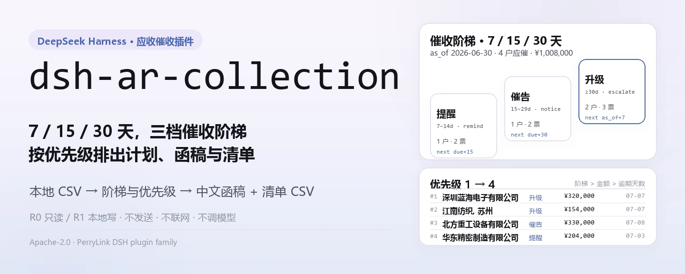
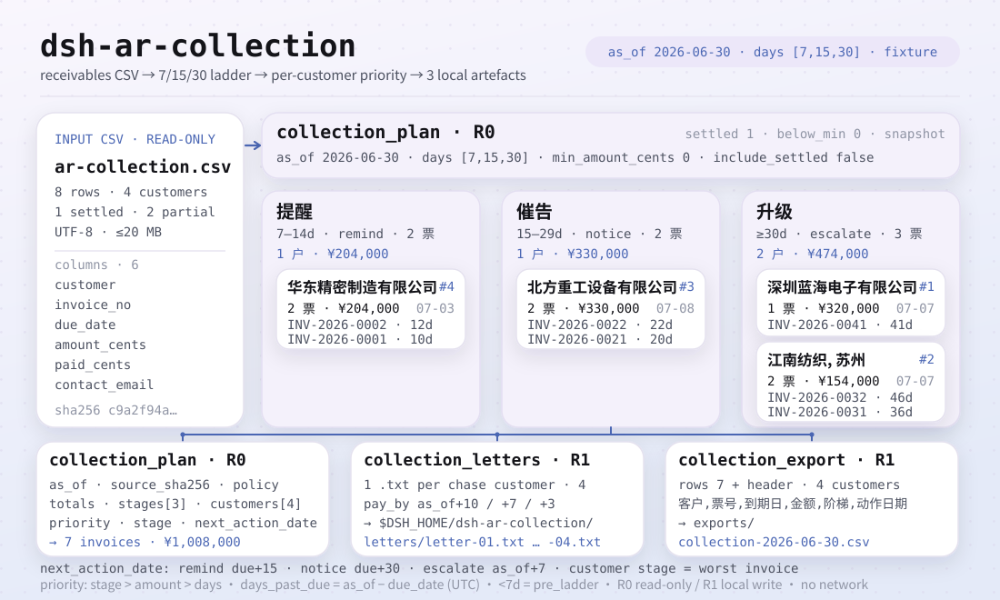
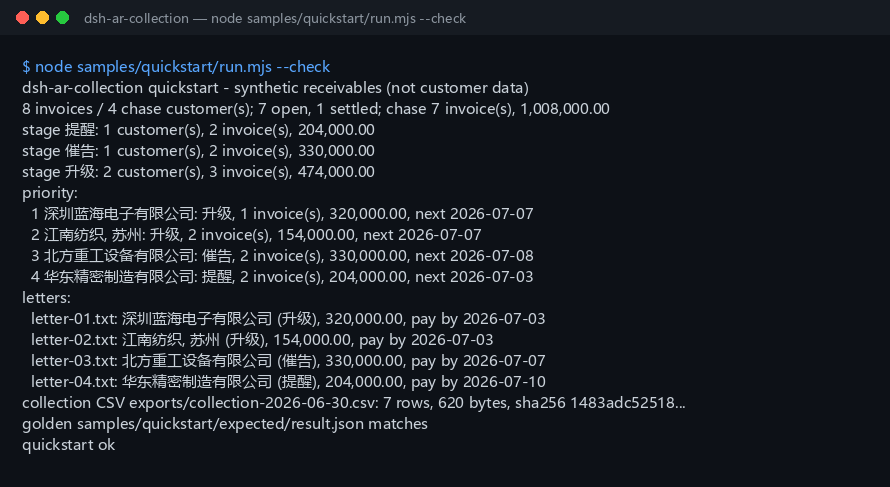

<div align="center">

<picture>
  <source media="(prefers-color-scheme: dark)" srcset="docs/assets/dsh-ar-collection-hero-zh-dark.webp">
  
</picture>

# dsh-ar-collection

**把应收明细变成按优先级排好的催收计划、中文催收函草稿和催收清单 CSV——全程本地，不联网、不发送。**

面向 DeepSeek Harness 的纯本地应收账款催收插件：读你指定的 CSV，按 7/15/30 天提醒阶梯算清每个客户该催哪几票、什么时候催，草稿与清单只写在你自己的机器上。

[安装](#三步上手) · [配置](#配置) · [FAQ](#faq) · [简体中文](README.md) · [English](README.en.md) · [Español](README.es.md) · [Português](README.pt.md) · [हिन्दी](README.hi.md)

[](LICENSE)
[](#兼容性)
[](https://www.npmjs.com/package/dsh-ar-collection)
[](https://github.com/PerryLink/dsh-ar-collection/actions/workflows/ci.yml)
[](#兼容性)

[](https://github.com/PerryLink/dsh-ar-collection/stargazers)
[](https://www.npmjs.com/package/dsh-ar-collection)
[](https://dshfind.com/plugins/PerryLink/dsh-ar-collection?ref=badge)
[](https://gitee.com/perrylink/dsh-ar-collection)

```sh
dsh plugin --profile <profile> add dsh-ar-collection
```

</div>

<sub>社区插件，与 DeepSeek 官方无关。唯一仓库：<https://github.com/PerryLink/dsh-ar-collection>（Gitee 为镜像）。</sub>

## 一句话

按 7/15/30 天提醒阶梯，把应收明细算成每个客户的催收计划（应催票数、应催金额、阶梯、下次动作日期、优先级），再在本地生成中文催收函草稿和催收清单 CSV。

> **状态：alpha / 公开合成 / partial / not counted / 非 GA。** 不含客户数据、客户证据，也不作生产可用、法律或审计结论声明。

<picture>
  <source media="(prefers-color-scheme: dark)" srcset="docs/assets/dsh-ar-collection-flow-v5-dark.svg">
  
</picture>

## 适合 / 不适合

- **适合**：几十到几千行的应收明细；需要按客户催收而不是只出一张账龄表；需要把“提醒 / 催告 / 升级”三档、下次动作日期和优先级固定下来；需要给应收会计一份可直接改的中文催收函草稿；需要把催收清单交给同事复核或归档。
- **不适合**：自动发送邮件、短信、微信或任何联网投递（本包只生成草稿，不发送）；多币种折算；利息、违约金、坏账准备或法律意见；按发票逐张发函且每张函格式不同的复杂模板；PDF / 扫描件 / Excel 直接输入（请先导出成 CSV）。

## 三步上手

1. **安装**（三选一）：

   ```sh
   # npm 通道（推荐，已发布版本）
   dsh plugin --profile <profile> add dsh-ar-collection
   # git 通道（最新 main；等价于 git+https://github.com/PerryLink/dsh-ar-collection.git）
   dsh plugin --profile <profile> add github:PerryLink/dsh-ar-collection
   # tarball 通道：本仓库 pnpm pack 后
   dsh plugin --profile <profile> add ./dsh-ar-collection-<version>.tgz
   ```

2. **验证已生效**：

   ```sh
   dsh --profile <profile> --dump-config | grep dsh-ar-collection
   ```

   然后把这句话发给 agent（对应内置样例 `samples/quickstart/input/ar-collection.csv`）：

   > 我有这份 8 行应收明细，用 7/15/30 天阶梯按 2026-06-30 生成催收计划、中文催收函草稿，再导出催收清单 CSV。

3. **复跑样例核对金标**（可选）：

   ```sh
   node samples/quickstart/run.mjs --check
   ```

**卸载**：`dsh plugin --profile <profile> remove dsh-ar-collection`。

<details>
<summary>从 DSH Desktop 市场安装</summary>

所有 PerryLink 插件均可在 DSH Desktop 内置市场中浏览：**市场 → 来源 → 添加来源 → 粘贴** `https://perrylink-dsh-catalog.perrylink.workers.dev/catalog-source.json` **→ 选中**。安装仍需通过市场的 npm 身份校验与你的确认。

</details>

## 核心能力

工具名是稳定 API；工具说明保留英文以匹配运行时输出。

| 工具 | 用途 | 风险 |
|---|---|---|
| `collection_plan` | 读取应收 CSV，按阶梯生成每个客户的应催票数/金额、阶梯、下次动作日期与优先级 | R0 |
| `collection_letters` | 为每个应催客户生成中文催收函 `.txt` 草稿，写本地 `letters/`；不发送、不联网 | R1 本地写 |
| `collection_export` | 导出催收清单 CSV（客户/票号/到期日/金额/阶梯/动作日期），返回路径与 sha256 | R1 本地写 |

## 输入

- 格式：UTF-8 CSV，首行表头，逗号分隔；支持 RFC 4180 引号、嵌入换行、CRLF 与 BOM。
- 表头：`customer,invoice_no,due_date,amount_cents,paid_cents,contact_email`。也接受 `客户 / 发票号 / 到期日 / 金额分 / 已收金额分 / 联系人邮箱` 等中文别名；多出的列会被忽略。
- 日期：`due_date` 必须是 `YYYY-MM-DD`；允许到期日晚于 `as_of`（尚未到期），这类发票不会进入催收计划，直到越过第一档。
- 金额：整数**分**；`amount_cents > 0`，`0 <= paid_cents <= amount_cents`；未收 = 应收 - 已收。
- 邮箱：`contact_email` 可以留空；非空时必须是 `name@example.com` 这种形式。留空时函件里用 `[联系人邮箱待补充]`。
- 发票号：同一文件内不能重复。
- 大小：单个文件 ≤ 20 MB；超过请按客户或月份拆文件。
- 来源：用户自己指定的本地 CSV；原文件只读，不会被修改。

## 输出

- **`collection_plan`**：`{ as_of, source_sha256, policy, totals, stages, customers }`。
  - `totals`：总行数、未收发票数、已结清发票数、应催票数/客户数/金额、三档客户数、低于最低金额被跳过的客户数、未到首档的发票数与金额。
  - `stages`：固定三档 `提醒` / `催告` / `升级`，含每档客户数、票数、金额。
  - `customers`：按优先级排序；每个客户有 `priority`、`invoice_count`、`amount_cents`、`stage`、`stage_label`、`next_action_date`、`next_action`、`max_days_past_due`、`oldest_due_date`、`contact_email`，以及逐票明细。
- **`collection_letters`**：给每个应催客户生成一份中文 `.txt` 草稿，写到 `$DSH_HOME/dsh-ar-collection/letters/`。每封含抬头、账龄摘要、明细表（票号/到期日/逾期天数/未收金额）、付款期限、联系人占位。返回文件名、路径、`sha256`、字节数。**不发送、不联网。**
- **`collection_export`**：把催收清单写成 CSV 到 `$DSH_HOME/dsh-ar-collection/exports/`，列固定为 `客户,票号,到期日,金额,阶梯,动作日期`；返回路径、`sha256`、字节数和行数。`include_settled=true` 时会在每个客户应催行后追加已结清发票（阶梯 `已结清`，动作日期留空）。

## 规则

1. 逾期天数 = `as_of - due_date`，按 UTC 日历日取整；允许负数（尚未到期）。
2. 只有逾期天数 ≥ 第一档（默认 7 天）的未收发票才进入催收计划；更早的发票计入 `pre_ladder_invoices`，不进计划。
3. 客户阶梯 = 该客户**逾期最久**那张发票所在档：`提醒`（7–14 天）、`催告`（15–29 天）、`升级`（30 天及以上）。
4. 客户下次动作日期 = 该客户所有应催发票“下一档日期”中最早的一个；`提醒`→`due+15`，`催告`→`due+30`，`升级`→`as_of + 第一档天数`（默认 +7 天复盘）。
5. 优先级：先按阶梯严重度（升级 > 催告 > 提醒），再按应催金额降序，再按最长逾期天数降序，最后按客户名升序。
6. `min_amount_cents` 按**客户应催总额**过滤，低于阈值的客户整户跳过；全部客户都被过滤掉时报 `E_COLLECTION_EMPTY`。
7. `include_settled=true` 时，只有已结清发票的客户也会以 `已结清` 阶段列入计划（金额 0，排在所有应催客户之后）；函件不会给已结清客户生成。
8. 函件付款期限：`提醒` 为 `as_of+10` 天，`催告` 为 `as_of+7` 天，`升级` 为 `as_of+3` 天。占位符（联系人姓名、电话、缺失邮箱）发送前必须人工补全。

## 示例

直接复制下面这句发给 agent：

> 我有这份 8 行应收明细，用 7/15/30 天阶梯按 2026-06-30 生成催收计划、中文催收函草稿，再导出催收清单 CSV。

用自带样例复跑并核对金标：

```sh
node samples/quickstart/run.mjs --check
```



样例是 8 行合成应收、4 个客户、1 张已结清，覆盖三档（1 个提醒 / 1 个催告 / 2 个升级）、一张部分收款，以及一个带逗号的客户名（`"江南纺织, 苏州"`，用于验证 CSV 引号转义）。金标 `samples/quickstart/expected/result.json` 由 `node samples/quickstart/run.mjs --json` 真实产生，不是手写；截图是 `--check` 的真实终端输出。

## 配置

插件本体没有 cordis 配置键（`cordis.patch.yml` 只 `insert` 一行，不含 `config`）；全部可调项都是三个工具的入参：

| 参数 | 默认值 | 含义 |
|---|---|---|
| `path` | （必填） | 应收明细 CSV 的本地路径；只读，不会被修改 |
| `as_of` | （必填） | 基准日期 `YYYY-MM-DD`；显式传值才能得到可复现的“今天” |
| `days` | `[7,15,30]` | 三档阶梯的起始天数；必须 3 个严格递增的正整数，如 `[3,5,10]`、`[10,20,45]` |
| `min_amount_cents` | `0` | 按**客户应催总额**过滤的最低金额（整数分）；低于阈值整户跳过 |
| `include_settled` | `false` | `true` 时已结清客户以 `已结清` 阶段列入计划、导出附已结清行；函件仍只给应催客户 |
| `filename_prefix` | `letter` | 仅 `collection_letters`：函件文件名前缀 |
| `filename` | 按 `as_of` 生成 | 仅 `collection_export`：导出文件名，只允许 `[A-Za-z0-9._-]` |

测试可用环境变量 `DSH_AR_COLLECTION_HOME` 覆盖本地写根目录，默认严格等于 `$DSH_HOME/dsh-ar-collection`。

## 权限

读：用户指定的应收明细 CSV（样例 `samples/quickstart/input/ar-collection.csv`）；不读其他目录。
写：`$DSH_HOME/dsh-ar-collection/letters/`（中文催收函草稿）与 `$DSH_HOME/dsh-ar-collection/exports/`（催收清单 CSV）；不改原 CSV。
联网：否。
外部系统：无。

`collection_plan` 标 **R0**（只读）；`collection_letters` 和 `collection_export` 标 **R1**（本地写，只写上面两个目录）。测试可用 `DSH_AR_COLLECTION_HOME` 覆盖本地写根目录，默认严格等于 `$DSH_HOME/dsh-ar-collection`。

## FAQ

<details>
<summary>催收函会自动发出去吗？</summary>

不会。`collection_letters` 只在本地写 `.txt` 草稿，不调用邮件、短信、IM、HTTP 或任何外部系统。联系人姓名、电话和缺失邮箱都是占位符，发送前必须人工复核并补全。本包不替你作发送决定。

</details>

<details>
<summary>阶梯能不能改？</summary>

可以。`days` 必须是 3 个严格递增的正整数，默认 `[7,15,30]`，例如 `[3,5,10]` 或 `[10,20,45]`。三档固定为“提醒 / 催告 / 升级”，改的是每档的起始天数。

</details>

<details>
<summary>已结清发票为什么不进计划？</summary>

默认 `include_settled=false`：已结清发票只计入 `totals.settled_invoices`，不催、不导出、不发函。传 `include_settled=true` 后，已结清客户会以 `已结清` 阶段出现在计划里（金额 0），导出时也会带出已结清行；函件仍然只给应催客户。

</details>

<details>
<summary>“最低金额”按单张票还是按客户？</summary>

按**客户应催总额**。同一客户有多张可催发票时先合计，再和 `min_amount_cents` 比较。低于阈值的客户整户跳过，并计入 `totals.below_min_customers`。

</details>

<details>
<summary>金额单位是元还是分？</summary>

工具 API 和输入都是**整数分**。`12800000` 表示 128,000.00 元。函件和 CSV 会格式化成两位小数，函件还带千分位，方便直接阅读。

</details>

<details>
<summary>会改我的文件或上传数据吗？</summary>

不会。只读用户指定的 CSV；只在本地写 `$DSH_HOME/dsh-ar-collection/` 下的两个子目录；不联网、不调用模型、不上传。原 CSV 不会被改写。

</details>

## 版本

`0.2.0` · 85 项测试通过（`node --test test/*.test.mjs`）。

## 错误码

| 错误码 | 何时出现 | 下一步 |
|---|---|---|
| `E_COLLECTION_CSV_ROW` | 列数不对、表头缺失/重复、客户/发票号为空、发票号重复、邮箱格式不对、阶梯参数不合法、文件超过 20 MB | 对照表头修这一行；阶梯必须 3 个严格递增正整数 |
| `E_COLLECTION_DATE_INVALID` | `due_date` 或 `as_of` 不是 `YYYY-MM-DD`、不是真实日期 | 统一日期格式并核对真实性 |
| `E_COLLECTION_AMOUNT` | 金额分不是正整数、金额为 0、已收超过应收、`min_amount_cents` 为负或非整数 | 金额一律填整数分，且 `0 <= paid <= amount` |
| `E_COLLECTION_PATH_INVALID` | 输入路径不存在/是目录/读不了，导出文件名含路径、空格、中文、超长，或写文件失败 | 传存在的 CSV；导出只传 `[A-Za-z0-9._-]` 文件名 |
| `E_COLLECTION_EMPTY` | CSV 为空/只有表头、全部已结清、没有客户越过第一档、或全部低于最低金额 | 确认 `as_of` 与 `days`；需要看已结清客户时传 `include_settled=true` |

报错原文格式：`<一句人话>（E_COLLECTION_XXX）｜下一步：<一个动作>`。更多排查见 [TROUBLESHOOTING.md](TROUBLESHOOTING.md)。

## 验收证据

公开/合成 fixture 在 `samples/quickstart/`；`ACCEPTANCE.csv` 记录 14 项工具检查 + 1 项 quickstart 金标，除 quickstart 行外均为 `counted=false`。

| req_id | metric | threshold | actual | pass | source | counted |
|---|---|---|---|---|---|---|
| AC-A01 | plan totals | rows=8 chase=7 amount=100800000 | rows=8 chase=7 amount=100800000 | true | public/synthetic | false |
| AC-A02 | three ladder stages | remind/notice/escalate = 1/1/2 | remind/notice/escalate = 1/1/2 | true | public/synthetic | false |
| AC-A03 | priority order | D/C/B/A | D/C/B/A | true | public/synthetic | false |
| AC-A05 | letter drafts | count=4 sections=ok | count=4 sections=ok | true | public/synthetic | false |
| AC-A06 | collection CSV | rows=7 lines=8 | rows=7 lines=8 | true | public/synthetic | false |
| PS1-QS01 | quickstart golden | 1/1 | 1 | true | synthetic/quickstart | true |

*这是 fixture 支撑的验收行，不是客户运行；没有编造输出。*

## 边界与已知限制

- **不发送**：只生成本地草稿；不接邮件/短信/IM，不做投递状态、退信或回复跟踪。
- **单币种未建模**：输入没有币种列，金额按同一种货币解释；多币种请拆文件或先在源系统折算。
- **不含利息/违约金**：只催未收本金；不计算滞纳金、利息、坏账准备或减值。
- **不含贷记单**：`amount_cents` 必须大于 0；红字发票/贷项通知单请先在源系统冲抵。
- **模板固定**：函件是内置中文模板；不做多语言函件、附件 PDF、签章或邮寄。
- 只读 CSV：不读 PDF / 扫描件 / Excel，不做 OCR。
- 日期按 UTC 日历日；跨时区的“今天”请显式传 `as_of`。
- 导出 CSV 只做 RFC 4180 引号转义，不做 Excel 公式前缀清洗；不要用 Excel 直接打开来源不明的 CSV。
- 仅公开/合成样例；alpha/partial、not counted，不作 GA 或生产可用声明。

## 兼容性

| 维度 | 状态 |
|---|---|
| Harness | `dsh >=0.2.1-rc.3 <0.4.0` |
| Node | `>=24.9.0 <25` |
| 平台 | 全平台；只读写本地文件 |
| 数据 | 不联网、不调用模型、不上传 |

## 生态与质量

- [Gitee 镜像](https://gitee.com/perrylink/dsh-ar-collection)（同步镜像，以 GitHub 为准）
- [dshfind 插件页](https://dshfind.com/plugins/PerryLink/dsh-ar-collection)（安装量与排名）

## 开发

```sh
pnpm install --frozen-lockfile
pnpm build && pnpm lint && pnpm typecheck
node --test test/*.test.mjs
node scripts/gate.mjs
```

配图由 [`scripts/gen-readme-assets.py`](scripts/gen-readme-assets.py) 程序化生成（Python + Pillow），可重复执行；`docs/assets/quickstart.png` 是 `--check` 的真实终端截图，不在脚本覆盖范围内。

Topics：`dsh`, `dsh-plugin`, `deepseek-harness`, `accounts-receivable`, `collections`, `dunning`, `receivables`, `finance`, `csv`, `perrylink`

## 相关项目

- [dsh-ar-aging](https://github.com/PerryLink/dsh-ar-aging)（应收账龄）
- [dsh-bankrec](https://github.com/PerryLink/dsh-bankrec)（银行流水对账）
- [领域索引](https://perrylink.github.io/dsh-plugins/)

## 家族与致谢

本项目是 [PerryLink](https://github.com/PerryLink) 维护的 DeepSeek Harness 插件家族成员（全部 Apache-2.0）。如果它帮到了你，**给个 star**——它不解锁任何功能，但会让下一个人更容易找到它。

- [@PerryLink](https://github.com/PerryLink) —— 创建者与维护者。

## License

[LICENSE](LICENSE)（Apache License 2.0）© 2026 dsh-ar-collection contributors。另见 `NOTICE`、`THIRD-PARTY-NOTICES`。

<p align="center"><sub>Apache-2.0 · 社区插件，与 DeepSeek 无关。</sub></p>
