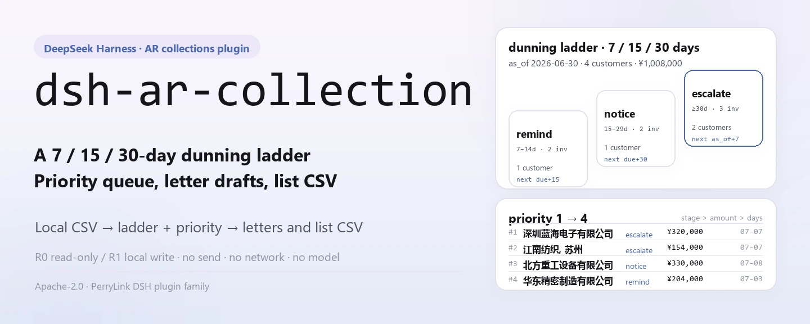
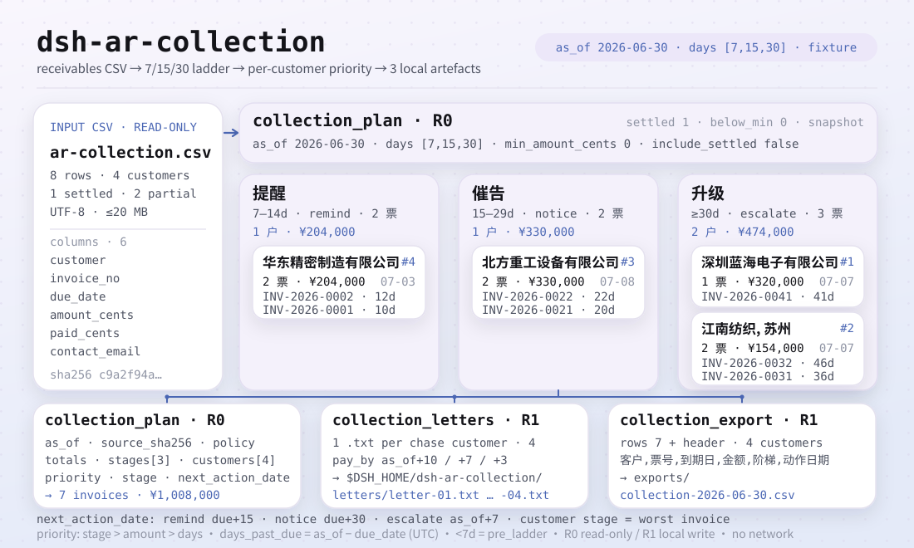
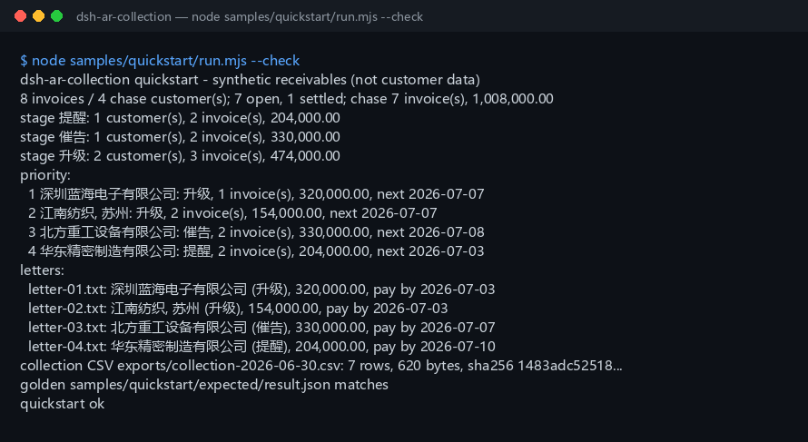

<div align="center">

<picture>
  <source media="(prefers-color-scheme: dark)" srcset="docs/assets/dsh-ar-collection-hero-en-dark.webp">
  
</picture>

# dsh-ar-collection

**Transforme um CSV de contas a receber em um plano de cobrança priorizado, rascunhos de cartas de cobrança em chinês e um CSV com a lista de cobrança — tudo local, sem rede e sem envios.**

Um plugin de cobrança puramente local para o DeepSeek Harness: lê o CSV que você indica, aplica uma escada de lembretes de 7/15/30 dias e calcula quais faturas cobrar de cada cliente e quando; os rascunhos e as listas só são gravados na sua própria máquina.

[Instalar](#instalação-em-três-passos) · [Configuração](#configuração) · [FAQ](#faq) · [简体中文](README.md) · [English](README.en.md) · [Español](README.es.md) · [Português](README.pt.md) · [हिन्दी](README.hi.md)

[](LICENSE)
[](#compatibilidade)
[](https://www.npmjs.com/package/dsh-ar-collection)
[](https://github.com/PerryLink/dsh-ar-collection/actions/workflows/ci.yml)
[](#compatibilidade)

[](https://github.com/PerryLink/dsh-ar-collection/stargazers)
[](https://www.npmjs.com/package/dsh-ar-collection)
[](https://dshfind.com/plugins/PerryLink/dsh-ar-collection?ref=badge)
[](https://gitee.com/perrylink/dsh-ar-collection)

```sh
dsh plugin --profile <profile> add dsh-ar-collection
```

</div>

<sub>Plugin da comunidade, sem afiliação com a DeepSeek. Repositório canônico: <https://github.com/PerryLink/dsh-ar-collection> (o Gitee é um espelho).</sub>

## Em uma frase

Aplica uma escada de lembretes de 7/15/30 dias a um razão de contas a receber e produz um plano de cobrança por cliente (faturas a cobrar, valor, degrau, próxima data de ação, prioridade), rascunhos de cartas em chinês e um CSV com a lista de cobrança, tudo localmente.

> **Status: alpha / sintético-público / parcial / não contado / não GA.** Sem dados de clientes, sem evidência de clientes e sem declaração de prontidão para produção, legal ou de auditoria.

<picture>
  <source media="(prefers-color-scheme: dark)" srcset="docs/assets/dsh-ar-collection-flow-v5-dark.svg">
  
</picture>

## Quando serve e quando não serve

- **Serve:** de dezenas a milhares de linhas; cobrar por cliente em vez de apenas produzir uma tabela de aging; fixar a escada `提醒` / `催告` / `升级`, a próxima data de ação e a prioridade; dar ao contador de contas a receber um rascunho de carta em chinês pronto para revisar; entregar uma lista de cobrança a um colega ou arquivá-la.
- **Não serve:** enviar e-mail/SMS/IM ou qualquer entrega pela rede (este pacote só redige rascunhos); conversão de moedas; juros, multas, provisão para devedores duvidosos ou aconselhamento jurídico; modelos de carta diferentes por fatura; PDF, digitalizações ou Excel como entrada direta (exporte primeiro para CSV).

## Instalação em três passos

1. **Instale** (escolha um canal):

   ```sh
   # canal npm (recomendado, versões publicadas)
   dsh plugin --profile <profile> add dsh-ar-collection
   # canal git (main mais recente; equivalente a git+https://github.com/PerryLink/dsh-ar-collection.git)
   dsh plugin --profile <profile> add github:PerryLink/dsh-ar-collection
   # canal tarball: pnpm pack neste repositório e depois
   dsh plugin --profile <profile> add ./dsh-ar-collection-<version>.tgz
   ```

2. **Verifique que montou**:

   ```sh
   dsh --profile <profile> --dump-config | grep dsh-ar-collection
   ```

   Depois cole esta frase no agente (aponta para o exemplo incluído `samples/quickstart/input/ar-collection.csv`):

   ```text
   我有这份 8 行应收明细，用 7/15/30 天阶梯按 2026-06-30 生成催收计划、中文催收函草稿，再导出催收清单 CSV。
   ```

3. **Reproduza o exemplo e compare com o arquivo dourado** (opcional):

   ```sh
   node samples/quickstart/run.mjs --check
   ```

**Desinstalar**: `dsh plugin --profile <profile> remove dsh-ar-collection`.

<details>
<summary>Instalar a partir do mercado do DSH Desktop</summary>

Todo plugin PerryLink está listado no mercado integrado do DSH Desktop: **Market → Sources → Add source → colar** `https://perrylink-dsh-catalog.perrylink.workers.dev/catalog-source.json` **→ selecionar**. A instalação ainda exige a verificação de identidade npm do mercado e a sua confirmação.

</details>

## Capacidades principais

Os nomes das ferramentas são API estável; as descrições permanecem em inglês para corresponder à saída em tempo de execução.

| Ferramenta | Propósito | Risco |
|---|---|---|
| `collection.plan` | Lê o CSV de contas a receber e produz as faturas/valores a cobrar de cada cliente, o degrau, a próxima data de ação e a prioridade | R0 |
| `collection.letters` | Grava um rascunho de carta de cobrança chinesa `.txt` por cliente cobrável em `letters/`; nunca envia, sem rede | R1 gravação local |
| `collection.export` | Grava o CSV da lista de cobrança (cliente / fatura / vencimento / valor / degrau / data de ação), devolvendo caminho + sha256 | R1 gravação local |

## Entrada

- CSV UTF-8 com linha de cabeçalho e separadores de vírgula. São suportados aspas RFC 4180, quebras de linha embutidas, CRLF e BOM UTF-8.
- Cabeçalho (os alias chineses também funcionam; colunas extras são ignoradas):

  ```text
  customer,invoice_no,due_date,amount_cents,paid_cents,contact_email
  客户,发票号,到期日,金额分,已收金额分,联系人邮箱
  ```

- Datas: `due_date` é estritamente `YYYY-MM-DD`. Um vencimento posterior a `as_of` é permitido (ainda não vencida); essa fatura fica fora do plano até atingir o primeiro degrau.
- Valores: **centavos** inteiros; `amount_cents > 0` e `0 <= paid_cents <= amount_cents`; em aberto = valor - recebido.
- E-mail: `contact_email` pode ficar vazio; quando presente deve parecer `name@example.com`. Um valor vazio vira este marcador fixo na carta:

  ```text
  [联系人邮箱待补充]
  ```

- Os números de fatura devem ser únicos dentro do arquivo.
- Tamanho: até 20 MB por arquivo; acima disso, divida por cliente ou por mês.
- Fonte: o CSV local que o usuário indica; é somente leitura e nunca é modificado.

## Saída

- **`collection.plan`**: `{ as_of, source_sha256, policy, totals, stages, customers }`.
  - `totals`: linhas do razão, faturas em aberto/liquidadas, faturas/clientes/valor cobráveis, clientes por degrau, clientes ignorados pelo valor mínimo e faturas/valor anteriores à escada.
  - `stages`: sempre os três degraus da escada com totais de clientes, faturas e valor.
  - `customers`: em ordem de prioridade; cada um tem `priority`, `invoice_count`, `amount_cents`, `stage`, `stage_label`, `next_action_date`, `next_action`, `max_days_past_due`, `oldest_due_date`, `contact_email` e o detalhe por fatura.
- **`collection.letters`**: um rascunho `.txt` em chinês por cliente cobrável em `$DSH_HOME/dsh-ar-collection/letters/`. Cada carta tem saudação, resumo de aging, tabela de detalhes (nº da fatura / vencimento / dias em atraso / em aberto), prazo de pagamento e marcadores de contato. Devolve nome do arquivo, caminho, `sha256` e bytes. **Nunca envia, nunca usa a rede.**
- **`collection.export`**: grava a lista de cobrança como CSV em `$DSH_HOME/dsh-ar-collection/exports/` com exatamente seis colunas fixas; devolve caminho, `sha256`, bytes e contagens de linhas. Com `include_settled=true`, as faturas liquidadas são acrescentadas após as linhas cobráveis de cada cliente (rótulo de degrau `已结清`, data de ação vazia).

Os rótulos de degrau e o cabeçalho do CSV exportado são tokens chineses fixos:

```text
stage labels: remind = 提醒 · notice = 催告 · escalate = 升级 · settled = 已结清
export header: 客户,票号,到期日,金额,阶梯,动作日期
```

## Regras

1. Dias em atraso = `as_of - due_date` em dias UTC inteiros; negativo significa ainda não vencida.
2. Apenas faturas em aberto no primeiro degrau ou além (dia 7 por padrão) são candidatas a cobrança. As anteriores contam em `pre_ladder_invoices` e ficam fora do plano.
3. O degrau de um cliente é o da sua fatura **mais atrasada**: `提醒` (7–14 dias), `催告` (15–29), `升级` (30+).
4. A próxima data de ação de um cliente é a data do próximo degrau mais próxima entre as suas faturas cobráveis: `提醒` → `due+15`, `催告` → `due+30`, `升级` → `as_of + primeiro dia da escada` (padrão +7).
5. Prioridade: severidade do degrau (`升级` > `催告` > `提醒`), depois valor cobrável decrescente, depois maior atraso, depois nome do cliente crescente.
6. `min_amount_cents` filtra clientes inteiros pelo seu total cobrável; se todos forem filtrados, a chamada devolve `E_COLLECTION_EMPTY`.
7. Com `include_settled=true`, clientes só liquidados entram no plano com o degrau `已结清` (valor 0) depois de todos os clientes cobráveis; as cartas continuam sendo geradas só para clientes cobráveis.
8. Prazos de pagamento nas cartas: `提醒` = `as_of+10` dias, `催告` = `as_of+7`, `升级` = `as_of+3`. Nome de contato, telefone e qualquer e-mail ausente ficam como marcadores que uma pessoa deve completar antes do envio.

## Exemplo

Cole esta frase no agente:

```text
我有这份 8 行应收明细，用 7/15/30 天阶梯按 2026-06-30 生成催收计划、中文催收函草稿，再导出催收清单 CSV。
```

Reproduza o exemplo incluído e compare com o arquivo dourado:

```sh
node samples/quickstart/run.mjs --check
```



O exemplo é um razão sintético de 8 linhas com 4 clientes e 1 fatura liquidada. Cobre os três degraus (1 `提醒` / 1 `催告` / 2 `升级`), inclui um pagamento parcial e um nome de cliente com vírgula, que exercita o escape de aspas do CSV:

```text
"江南纺织, 苏州"
```

`samples/quickstart/expected/result.json` é a saída real de `node samples/quickstart/run.mjs --json`, não escrita à mão; a captura de tela é a saída real do `--check`.

## Configuração

O plugin em si não tem chaves de configuração cordis (`cordis.patch.yml` apenas faz `insert` de uma linha, sem `config`); todos os ajustes são argumentos das ferramentas:

| Argumento | Padrão | Significado |
|---|---|---|
| `path` | (obrigatório) | Caminho local do CSV de contas a receber; somente leitura, nunca modificado |
| `as_of` | (obrigatório) | Data base `YYYY-MM-DD`; passe explicitamente para um "hoje" reproduzível |
| `days` | `[7,15,30]` | Dia inicial de cada degrau; três inteiros positivos estritamente crescentes, ex. `[3,5,10]`, `[10,20,45]` |
| `min_amount_cents` | `0` | Total cobrável mínimo **por cliente** (centavos inteiros); clientes abaixo são ignorados por inteiro |
| `include_settled` | `false` | `true` lista clientes só liquidados com o degrau `已结清` e acrescenta linhas liquidadas à exportação; as cartas continuam cobrindo só clientes cobráveis |
| `filename_prefix` | `letter` | Apenas `collection.letters`: prefixo do nome de arquivo das cartas |
| `filename` | derivado de `as_of` | Apenas `collection.export`: nome do arquivo exportado, apenas caracteres `[A-Za-z0-9._-]` |

Os testes podem sobrescrever a raiz de gravação local com a variável de ambiente `DSH_AR_COLLECTION_HOME`; o padrão é exatamente `$DSH_HOME/dsh-ar-collection`.

## Permissões

Leitura: o CSV de contas a receber que o usuário indica (exemplo: `samples/quickstart/input/ar-collection.csv`); nada mais.
Gravação: `$DSH_HOME/dsh-ar-collection/letters/` (rascunhos de cartas) e `$DSH_HOME/dsh-ar-collection/exports/` (CSV de cobrança) apenas; o CSV de origem não é modificado.
Rede: não.
Sistemas externos: nenhum.

`collection.plan` é **R0** (somente leitura). `collection.letters` e `collection.export` são **R1** (gravação local apenas nas duas pastas acima). `DSH_AR_COLLECTION_HOME` pode sobrescrever a raiz de gravação local em testes; o padrão é exatamente `$DSH_HOME/dsh-ar-collection`.

## FAQ

<details>
<summary>As cartas são enviadas automaticamente?</summary>

Não. `collection.letters` grava rascunhos `.txt` localmente e nunca chama e-mail, SMS, IM, HTTP ou qualquer sistema externo. Nome de contato, telefone e um e-mail ausente ficam como marcadores; uma pessoa deve revisá-los e completá-los antes do envio. Este pacote não decide o envio por você.

</details>

<details>
<summary>A escada pode ser alterada?</summary>

Sim. `days` deve ser três inteiros positivos estritamente crescentes, padrão `[7,15,30]`, por exemplo `[3,5,10]` ou `[10,20,45]`. Os três nomes de degrau continuam sendo os rótulos chineses fixos (`提醒` / `催告` / `升级`); apenas os dias iniciais mudam.

</details>

<details>
<summary>Por que as faturas liquidadas são excluídas?</summary>

Com o padrão `include_settled=false`, as faturas liquidadas só contam em `totals.settled_invoices`; não são cobradas, nem exportadas, nem recebem carta. Com `include_settled=true`, clientes só liquidados aparecem com o degrau `已结清` (valor 0) e as linhas liquidadas são acrescentadas à exportação; as cartas continuam cobrindo apenas clientes cobráveis.

</details>

<details>
<summary>O valor mínimo é por fatura ou por cliente?</summary>

Por **total cobrável do cliente**. Se as faturas cobráveis de um cliente somarem menos de `min_amount_cents`, o cliente inteiro é ignorado e contado em `totals.below_min_customers`.

</details>

<details>
<summary>Os valores são em yuan ou em centavos?</summary>

As entradas e as APIs das ferramentas usam **centavos** inteiros. `12800000` significa 128.000,00. As cartas e o CSV mostram duas casas decimais; as cartas também adicionam separadores de milhar.

</details>

<details>
<summary>Ele modifica ou envia meu arquivo?</summary>

Não. Lê o CSV indicado, grava apenas nas duas pastas sob `$DSH_HOME/dsh-ar-collection/` e nunca usa a rede, uma chamada de modelo ou um upload. O CSV de origem não é modificado.

</details>

## Versão

`0.1.0` · 83 testes passam (`node --test test/*.test.mjs`).

## Códigos de erro

| Código | Quando | Próxima ação |
|---|---|---|
| `E_COLLECTION_CSV_ROW` | Contagem de colunas errada, cabeçalho ausente/duplicado, cliente/fatura vazios, fatura duplicada, e-mail inválido, escada inválida, arquivo > 20 MB | Corrija a linha indicada; `days` deve ser três inteiros positivos estritamente crescentes |
| `E_COLLECTION_DATE_INVALID` | `due_date` ou `as_of` não é uma data `YYYY-MM-DD` real | Use datas ISO e verifique que existem |
| `E_COLLECTION_AMOUNT` | Centavos não inteiros positivos, valor zero, recebido acima do valor, `min_amount_cents` negativo/fracionário | Centavos inteiros com `0 <= paid <= amount` |
| `E_COLLECTION_PATH_INVALID` | Entrada ausente/diretório/ilegível, nome de exportação inseguro ou falha de gravação | Passe um CSV existente; exporte apenas com `[A-Za-z0-9._-]` |
| `E_COLLECTION_EMPTY` | CSV vazio/só cabeçalho, tudo liquidado, nenhum cliente além do primeiro degrau ou todos abaixo do mínimo | Verifique `as_of` e `days`; passe `include_settled=true` para ver clientes liquidados |

O formato da mensagem é:

```text
<one sentence>（E_COLLECTION_XXX）｜下一步：<one action>
```

Veja [TROUBLESHOOTING.md](TROUBLESHOOTING.md).

## Evidência de aceitação

Os fixtures públicos/sintéticos ficam em `samples/quickstart/`; `ACCEPTANCE.csv` registra 14 verificações de ferramentas mais o dourado do quickstart. Todas as linhas são `counted=false` exceto a do quickstart.

| req_id | metric | threshold | actual | pass | source | counted |
|---|---|---|---|---|---|---|
| AC-A01 | plan totals | rows=8 chase=7 amount=100800000 | rows=8 chase=7 amount=100800000 | true | public/synthetic | false |
| AC-A02 | three ladder stages | remind/notice/escalate = 1/1/2 | remind/notice/escalate = 1/1/2 | true | public/synthetic | false |
| AC-A03 | priority order | D/C/B/A | D/C/B/A | true | public/synthetic | false |
| AC-A05 | letter drafts | count=4 sections=ok | count=4 sections=ok | true | public/synthetic | false |
| AC-A06 | collection CSV | rows=7 lines=8 | rows=7 lines=8 | true | public/synthetic | false |
| PS1-QS01 | quickstart golden | 1/1 | 1 | true | synthetic/quickstart | true |

*Linhas respaldadas por fixtures, não uma execução de cliente; nenhuma saída é inventada.*

## Limites e limitações conhecidas

- **Sem envios:** apenas rascunhos locais; sem integração de e-mail/SMS/IM, status de entrega, rastreamento de devolução ou resposta.
- **Sem modelo de moeda:** a entrada não tem coluna de moeda, então todos os valores são interpretados como uma única moeda. Divida arquivos ou converta no sistema de origem.
- **Apenas principal:** sem juros, multas, provisão para devedores duvidosos ou impairment.
- **Sem notas de crédito:** `amount_cents` deve ser > 0; compense primeiro as faturas retificativas no sistema de origem.
- **Modelo fixo:** um modelo chinês embutido; sem cartas multilíngues, anexos PDF, assinatura eletrônica ou envio postal.
- Apenas CSV: nada de PDF, digitalizações ou Excel, e nada de OCR.
- As datas usam dias corridos UTC; passe `as_of` explicitamente para um "hoje" reproduzível.
- O CSV exportado aplica apenas escape de aspas RFC 4180; prefixos de fórmula do Excel não são higienizados.
- Apenas local: sem rede, sem chamada de modelo, sem upload.
- Apenas amostras públicas/sintéticas; alpha/parcial, não contado, sem declaração de GA ou prontidão para produção.

## Compatibilidade

| Superfície | Status |
|---|---|
| Harness | `dsh >=0.2.1-rc.3 <0.4.0` |
| Node | `>=24.9.0 <25` |
| Plataformas | Todas; apenas arquivos locais |
| Dados | Sem rede, sem chamada de modelo, sem upload |

## Ecossistema e qualidade

- [Espelho do Gitee](https://gitee.com/perrylink/dsh-ar-collection) (espelho sincronizado; o GitHub é o canônico)
- [Página do plugin no dshfind](https://dshfind.com/plugins/PerryLink/dsh-ar-collection) (instalações e ranking)

## Desenvolvimento

```sh
pnpm install --frozen-lockfile
pnpm build && pnpm lint && pnpm typecheck
node --test test/*.test.mjs
node scripts/gate.mjs
```

O diagrama de fluxo do README é gerado programaticamente por [`scripts/gen-readme-assets.py`](scripts/gen-readme-assets.py) (Python + Pillow) e pode ser reexecutado com segurança; `docs/assets/quickstart.png` é a captura de terminal real do `--check` e não é sobrescrita pelo script.

Topics: `dsh`, `dsh-plugin`, `deepseek-harness`, `accounts-receivable`, `collections`, `dunning`, `receivables`, `finance`, `csv`, `perrylink`

## Projetos relacionados

- [dsh-ar-aging](https://github.com/PerryLink/dsh-ar-aging) (aging de contas a receber)
- [dsh-bankrec](https://github.com/PerryLink/dsh-bankrec) (conciliação bancária)
- [Índice de domínios](https://perrylink.github.io/dsh-plugins/)

## Família e agradecimentos

Este projeto faz parte da família de plugins DeepSeek Harness da [PerryLink](https://github.com/PerryLink) (todos Apache-2.0). Se for útil, **uma estrela ajuda a próxima pessoa a encontrá-lo** — nada fica bloqueado atrás dela.

- [@PerryLink](https://github.com/PerryLink) — criador e mantenedor.

## Licença

[LICENSE](LICENSE) (Apache License 2.0) © 2026 dsh-ar-collection contributors. Veja também `NOTICE`, `THIRD-PARTY-NOTICES`.

<p align="center"><sub>Apache-2.0 · Plugin da comunidade, sem afiliação com a DeepSeek.</sub></p>
